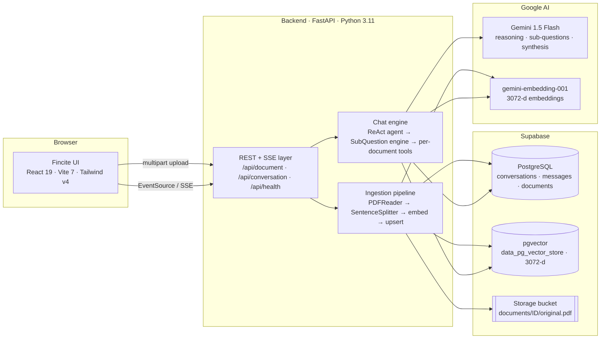
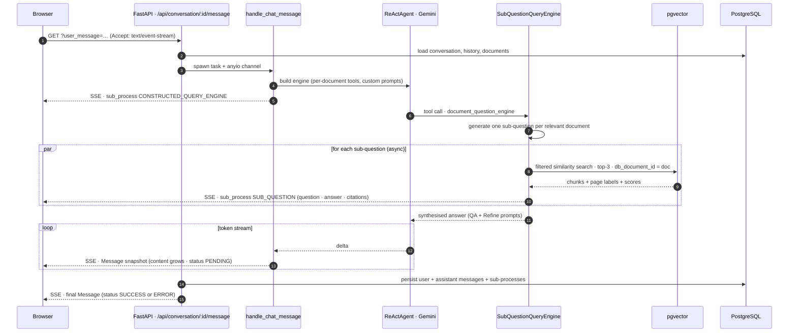
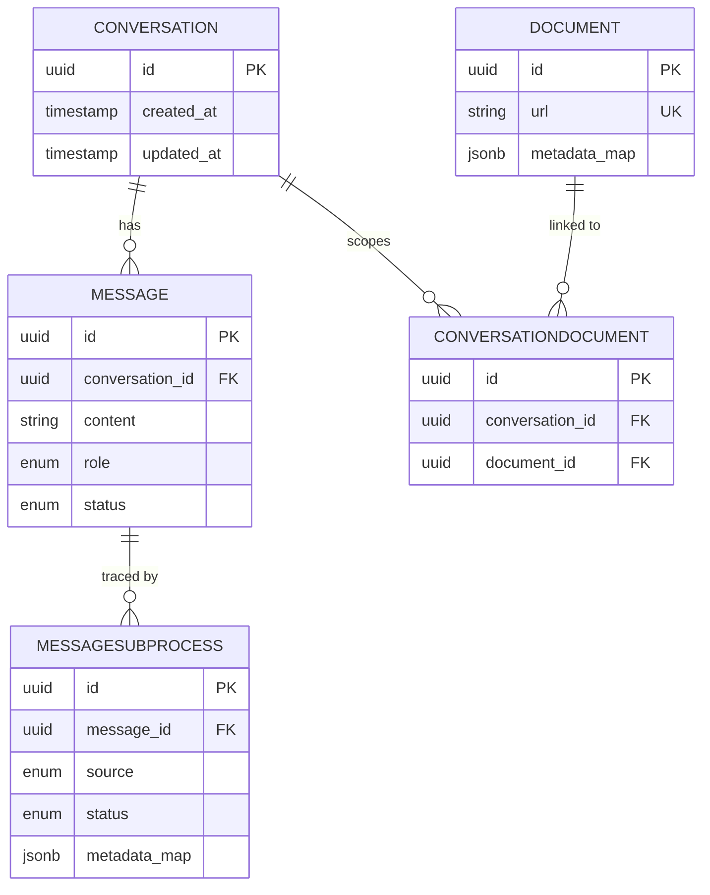

<div align="center">

# Fincite

### Ask the filings. Every claim, pinned to a page.

**An AI research terminal for Indian / NSE company annual reports and corporate filings.**<br/>
Upload PDFs, ask questions in plain English, and get answers that cite the exact page they came from.

<br/>

[](backend/pyproject.toml)
[](backend/app/main.py)
[](backend/app/chat/engine.py)
[](backend/app/llama_index_settings.py)
[](backend/app/storage/supabase.py)
[](frontend/package.json)
[](frontend/tsconfig.json)
[](frontend/src/index.css)
[](backend/tests)
[](LICENSE)

<br/>

[**Product**](#1-product) · [**How it works**](#2-how-it-works) · [**Engineering**](#3-engineering) · [**Repository structure**](#4-repository-structure) · [**Capabilities today**](#5-current-capabilities) · [**Quick start**](#6-quick-start) · [**API**](#7-api-surface) · [**Roadmap**](#9-roadmap)

</div>

---

## 1. Product

### 1.1 The problem

An Indian listed company's annual report is routinely **250–400 pages** of PDF: audited financials, MD&A, board reports, ESG disclosures, risk factors, notes to accounts. Analysts, students, retail investors and journalists all ask the same kinds of questions —

> *"What was consolidated revenue in FY2025 versus FY2024?"*
> *"What did management say about input-cost inflation?"*
> *"Compare the capex guidance of these two companies."*

— and answer them the slow way: Ctrl-F across multiple PDFs, copy numbers into a spreadsheet, and hope nothing was mis-read. General-purpose chatbots are worse: they hallucinate figures, silently convert **₹ Crore** to millions, and blur one financial year into another.

### 1.2 The product

**Fincite** is a focused, retrieval-augmented research assistant for exactly this corpus. You build a private library of filings, open a research thread scoped to one or many of them, and interrogate the documents conversationally. Every answer is:

| Principle | What it means in practice |
|---|---|
| **Grounded** | The model is instructed to *always* consult the documents through its tools before answering, and to say so explicitly when a figure is not in the retrieved context. |
| **Pinned to a page** | Retrieval carries page labels through the whole pipeline; citations include document, page number, the quoted passage and a relevance score. |
| **Unit-faithful** | Figures are reported in the units the filing uses (₹ Crore, ₹ Lakh, USD Million) — never silently converted. |
| **Year-aware** | FY2025 vs FY2024 is disambiguated in every answer; cross-document comparisons attribute each data point to the right company and year. |
| **Transparent** | A live *research trail* shows the work: engine construction, sub-questions generated per document, retrieval, synthesis — streamed as it happens. |
| **On-topic** | Off-topic requests are politely declined; the assistant is a financial-research specialist, not a general chatbot. |

### 1.3 Who it is for

- **Equity analysts & finance students** who need numbers with provenance.
- **Retail investors** who want to read filings without reading *all* of the filing.
- **Engineers** evaluating a production-shaped RAG reference: agentic multi-document reasoning, per-document retrieval isolation, streamed observability, and clean service boundaries.

---

## 2. How it works

A single research session, end to end:

```
   ┌──────────────┐     ┌──────────────────┐     ┌──────────────────┐     ┌────────────────────┐
   │ 1. UPLOAD    │ ──▶ │ 2. INDEX         │ ──▶ │ 3. ASK           │ ──▶ │ 4. READ & VERIFY   │
   │ Drop a PDF   │     │ Parse → chunk →  │     │ Open a thread    │     │ Streamed answer +  │
   │ annual report│     │ embed → pgvector │     │ scoped to 1..n   │     │ research trail +   │
   │ + metadata   │     │ (page-labelled)  │     │ filings, ask     │     │ page-level sources │
   └──────────────┘     └──────────────────┘     └──────────────────┘     └────────────────────┘
```

1. **Upload** — `POST /api/document/upload` with the PDF and optional NSE metadata (company, ticker, financial year, document type). Duplicates are detected by SHA-256 and returned idempotently.
2. **Index** — the PDF is stored in Supabase Storage, parsed page-by-page, split into sentence-aware chunks, embedded with Gemini, and written to pgvector with the document ID stamped on every node.
3. **Ask** — create a conversation over any set of indexed documents, then send a question. The agent decides which documents to consult, breaks the question into per-document sub-questions, retrieves and synthesises.
4. **Read & verify** — the answer streams token-by-token over Server-Sent Events alongside structured sub-process events, so the UI can render a research trail and clickable `[n]` citations that open the exact passage.

---

## 3. Engineering

### 3.1 System architecture



| Layer | Technology | Why |
|---|---|---|
| **API** | FastAPI · Pydantic v2 · `sse-starlette` | Async-native, typed request/response models, first-class OpenAPI docs, SSE without WebSockets. |
| **Orchestration** | LlamaIndex 0.12 (`ReActAgent`, `SubQuestionQueryEngine`, `VectorStoreIndex`) | Battle-tested primitives for agentic RAG; callback system doubles as the observability bus. |
| **Models** | Google Gemini — `gemini-1.5-flash` (chat) · `gemini-embedding-001` (3072-d) | Fast, inexpensive long-context model for multi-step reasoning; high-dimensional embeddings for dense financial prose. |
| **Data** | PostgreSQL + pgvector (Supabase) · SQLAlchemy 2 async · Alembic | One database for relational state *and* vectors — no separate vector DB to operate; migrations are versioned. |
| **Object storage** | Supabase Storage | Original PDFs are kept for re-indexing and future viewer features; service-role key stays server-side. |
| **Frontend** | React 19 · TypeScript (strict) · Vite 7 · Tailwind CSS v4 · Framer Motion | Lightweight, no heavy state library; design-token driven editorial UI. |
| **Packaging** | `uv` + `hatchling` · multi-stage Docker · `docker compose` | Reproducible, lock-file-driven Python installs; cached dependency layers. |
| **Quality** | `pytest` + `pytest-asyncio` (backend) · `tsc --strict` (frontend) · Sentry hook | Unit tests run with zero external services. |

### 3.2 The retrieval & reasoning harness

The core of Fincite is a **three-tier query harness** built in [`backend/app/chat/engine.py`](backend/app/chat/engine.py). Each tier has one job:

```
            ┌──────────────────────────────────────────────────────────────────────┐
  Tier 1    │  ReActAgent  (Gemini · max 6 iterations · system prompt w/ doc list) │
            │  "Should I use a tool? Which? Is the answer complete?"               │
            └───────────────────────────────┬──────────────────────────────────────┘
                                            │ single tool: document_question_engine
            ┌───────────────────────────────▼──────────────────────────────────────┐
  Tier 2    │  SubQuestionQueryEngine  (LLMQuestionGenerator · async fan-out)      │
            │  "Split the question into one sub-question per relevant document."   │
            │  Custom QA + Refine prompts enforce units & financial-year hygiene.  │
            └───────┬──────────────────────────┬───────────────────────┬───────────┘
                    │                          │                       │
            ┌───────▼────────┐        ┌────────▼───────┐       ┌───────▼────────┐
  Tier 3    │ QueryEngineTool│        │ QueryEngineTool│  ...  │ QueryEngineTool│
            │ doc A · top-3  │        │ doc B · top-3  │       │ doc N · top-3  │
            │ filter:        │        │ filter:        │       │ filter:        │
            │ db_document_id │        │ db_document_id │       │ db_document_id │
            └───────┬────────┘        └────────┬───────┘       └───────┬────────┘
                    └──────────────────────────┴───────────────────────┘
                                               │
                                   ┌───────────▼───────────┐
                                   │  pgvector (one table) │
                                   │  cosine · 3072-d      │
                                   └───────────────────────┘
```

**Design decisions worth knowing:**

- **One tool per document, isolated by metadata filter.** All documents share a single pgvector table, but each `QueryEngineTool` applies an `ExactMatchFilter(db_document_id = …)`. Cross-contamination between filings is impossible by construction, and the tool *description* (built from NSE metadata — *"Annual report for Reliance Industries (RELIANCE), financial year 2025 (exchange: NSE)."*) is what lets the LLM route sub-questions correctly.
- **Sub-question decomposition before retrieval.** "Compare X across A and B" becomes two targeted sub-questions executed concurrently (`use_async=True`), each answered from its own document, then synthesised. This is what makes multi-document comparison reliable rather than lucky.
- **Domain-specific prompts at every tier.** The system prompt, the QA prompt and the Refine prompt all restate the same contract: use tools first, preserve units, name the financial year, cite pages, never fabricate. Redundancy here is deliberate — it is cheap and measurably reduces drift.
- **The callback bus *is* the observability layer.** A custom `ChatCallbackHandler` turns LlamaIndex `CBEventType` events (`SUB_QUESTION`, `RETRIEVE`, `LLM`, `SYNTHESIZE`, …) into typed `MessageSubProcess` records, pushes them through an `anyio` memory channel, and the SSE endpoint fans them out to the client — *and* persists them, so a conversation's full reasoning trace survives reloads.
- **Index-once, query-many.** The vector index is persistent in pgvector; building a chat engine never re-embeds. If an index cannot be loaded, the engine falls back to re-ingesting the PDF from Storage.

### 3.3 Streaming request lifecycle



Every SSE event is a complete JSON `Message` snapshot — content and `sub_processes` grow monotonically — so clients are trivially resumable and never have to reassemble partial deltas.

### 3.4 Ingestion pipeline

```
PDF bytes ─▶ validate (MIME + %PDF magic) ─▶ SHA-256 dedupe ─▶ UUID
        ─▶ Supabase Storage  documents/{id}/original.pdf
        ─▶ Postgres  document row  { url, metadata_map: { nse_document, content_hash, original_filename } }
        ─▶ PDFReader (page-labelled LlamaIndex Documents, db_document_id stamped)
        ─▶ SentenceSplitter  chunk 512 · overlap 10
        ─▶ GeminiEmbedding  3072-d
        ─▶ pgvector  data_pg_vector_store
        ─▶ 201 { status: "indexed" }
```

Failure at any step after storage **rolls back** both the Storage object and the DB row, so the library never contains a document that can't be queried.

### 3.5 Data model



Vectors live alongside in `data_pg_vector_store` (managed by LlamaIndex), linked to `DOCUMENT` through `metadata_.db_document_id`. Schema evolution is handled by six Alembic migrations in [`backend/alembic/versions`](backend/alembic/versions).

### 3.6 Process model

`uv run start` performs deploy-time bootstrap **once** in the parent process — wait for DB, verify Alembic is at head, `CREATE EXTENSION vector`, create vector tables, pre-fetch NLTK tokenizer data — then launches `uvicorn` with `BACKEND_WORKERS` (default 4) worker processes. Each worker's lifespan only does per-process work: configure Gemini settings off the event loop, open its own connection pools, and close them on shutdown. The vector store deliberately **shares the app's async engine**, so a worker holds one pool, not two.

---

## 4. Repository structure

```
fincitee/
├── backend/                         # FastAPI + LlamaIndex service  → see backend/README.md
│   ├── app/
│   │   ├── main.py                  #   bootstrap, lifespan, uvicorn entrypoint
│   │   ├── core/config.py           #   pydantic-settings; env validation & URL normalisation
│   │   ├── llama_index_settings.py  #   Gemini LLM + embeddings + SentenceSplitter
│   │   ├── api/
│   │   │   ├── api.py               #   router registry (/conversation, /document, /health)
│   │   │   ├── crud.py              #   async SQLAlchemy data access
│   │   │   ├── deps.py              #   DB session dependency
│   │   │   └── endpoints/           #   conversation.py (SSE) · documents.py (upload) · health.py
│   │   ├── chat/
│   │   │   ├── engine.py            #   ReAct → SubQuestion → per-document tools
│   │   │   ├── messaging.py         #   callback handler → anyio channel → stream
│   │   │   ├── qa_response_synth.py #   custom QA / Refine prompts
│   │   │   ├── pg_vector.py         #   pool-sharing PGVectorStore singleton
│   │   │   ├── constants.py         #   system prompt, chunking constants
│   │   │   └── utils.py             #   document title / tool-description builders
│   │   ├── ingestion/pdf.py         #   PDF → nodes → embeddings → pgvector
│   │   ├── storage/supabase.py      #   upload / download / delete / public URL
│   │   ├── models/                  #   SQLAlchemy declarative models + PG enums
│   │   ├── db/                      #   async engine, session, wait-for-db
│   │   └── schema.py                #   Pydantic API schemas incl. NSE metadata + citations
│   ├── alembic/                     #   6 versioned migrations
│   ├── scripts/                     #   SSE chat CLI, vector-table builder, dedupe tool
│   ├── tests/                       #   15 unit tests, fully mocked (no DB / API key)
│   ├── Dockerfile · docker-compose.yml · pyproject.toml · uv.lock · .env.example
│
├── frontend/                        # React research terminal  → see frontend/README.md
│   ├── src/
│   │   ├── App.tsx                  #   shell: ticker · sidebar · views · drawers · splash
│   │   ├── store.tsx                #   React-context store: docs, threads, streaming, health
│   │   ├── lib/
│   │   │   ├── api.ts               #   API client: Mock transport ⇄ Real transport (SSE)
│   │   │   ├── types.ts             #   domain types mirroring backend schemas
│   │   │   └── format.ts            #   labels, formatters
│   │   └── components/              #   ChatView · LibraryView · MessageItem · ResearchTrail
│   │                                #   CiteMarkdown · SourceDrawer · Sidebar · Composer …
│   ├── index.html · vite.config.ts · tsconfig.json · package.json
│
├── LICENSE                          # MIT
└── README.md                        # you are here
```

---

## 5. Current capabilities

What you can do **today**, by subsystem:

| Area | Capability | Status |
|---|---|---|
| **Ingestion** | Upload PDF with NSE metadata (company, ticker, FY, type, exchange) | ✅ |
| | MIME + magic-byte validation; empty-file rejection | ✅ |
| | SHA-256 duplicate detection (idempotent re-upload) | ✅ |
| | Page-labelled parsing → sentence-aware chunking → Gemini embeddings → pgvector | ✅ |
| | Atomic rollback of Storage + DB on indexing failure | ✅ |
| **Conversations** | Create / fetch / delete conversations scoped to 1..n documents | ✅ |
| | Chat history replay (failed / empty messages filtered out) | ✅ |
| **Reasoning** | ReAct agent with domain system prompt (units, FY, citations, refusal) | ✅ |
| | Per-document isolated retrieval (metadata-filtered, top-3) | ✅ |
| | Multi-document sub-question decomposition with async fan-out | ✅ |
| | Custom QA / Refine synthesis prompts | ✅ |
| **Streaming** | SSE token stream with structured sub-process events | ✅ |
| | Page-level citations with passage text + relevance score | ✅ |
| | Full reasoning trace persisted per message | ✅ |
| **Ops** | One-shot deploy bootstrap, multi-worker uvicorn, pooled connections | ✅ |
| | Alembic migrations with head verification at boot | ✅ |
| | Docker image + compose with local pgvector | ✅ |
| | Optional Sentry, configurable CORS, structured logging | ✅ |
| | OpenAPI / Swagger / ReDoc at `/api/docs`, `/api/redoc` | ✅ |
| **Frontend** | Research threads, streaming answers, research trail, citation chips, source drawer | ✅ UI |
| | Filing library: drag-and-drop upload, search, detail drawer, scoped threads | ✅ UI |
| | Live backend transport | 🟡 UI ships against an in-browser **mock transport**; the real SSE transport is scaffolded and wiring it is the next milestone — see [`frontend/README.md`](frontend/README.md#6-connecting-to-the-real-backend) |
| **Auth** | Multi-tenant auth / per-user libraries | ⬜ not yet |
| **Async indexing** | Background job queue for very large PDFs | ⬜ not yet (upload is synchronous) |

### Try it in the sandbox

Three ways to exercise the backend without writing any client code:

```bash
# 1. Swagger UI — interactive, every endpoint (use /test_message for a non-streamed answer)
open http://localhost:8000/api/docs

# 2. Raw SSE with curl — watch the research trail arrive event by event
curl -N "http://localhost:8000/api/conversation/<CONVERSATION_ID>/message?user_message=What%20was%20FY2025%20revenue%3F"

# 3. Interactive terminal client (fetch → select → create → message)
cd backend && uv run python scripts/chat_llama.py --base_url http://localhost:8000
```

---

## 6. Quick start

### 6.1 Prerequisites

| Requirement | Notes |
|---|---|
| **Python 3.11.x** and [`uv`](https://docs.astral.sh/uv/) | `requires-python = ">=3.11,<3.12"` |
| **Node 20+** and npm | for the frontend |
| **PostgreSQL with pgvector** | a Supabase project (recommended) **or** the bundled `docker compose` database |
| **Supabase project** | Storage bucket (default name `annual-reports`) + service-role key |
| **Google AI Studio API key** | https://aistudio.google.com/apikey |

### 6.2 Backend

```bash
cd backend
cp .env.example .env          # fill in DATABASE_URL, SUPABASE_*, GOOGLE_API_KEY
uv sync                        # installs from uv.lock (dev group included)
uv run alembic upgrade head    # create tables
uv run start                   # bootstrap + uvicorn on http://0.0.0.0:8000
```

Or with Docker (local pgvector included — you still need Supabase Storage + Gemini credentials in `.env`):

```bash
cd backend && docker compose up --build
```

### 6.3 Frontend

```bash
cd frontend
npm install
npm run dev                    # http://localhost:5173 — runs against the mock transport by default
```

> On a fresh clone the frontend needs two one-line fixes before it type-checks (a missing `mockData.ts` and an unterminated comment in `types.ts`) — see [frontend/README.md § Current status](frontend/README.md#5-current-status).

To point at a running backend set `VITE_API_URL=http://localhost:8000` and flip `USE_MOCK` in [`src/lib/api.ts`](frontend/src/lib/api.ts); add `http://localhost:5173` to `BACKEND_CORS_ORIGINS`. The full wiring checklist is in the [frontend README](frontend/README.md#6-connecting-to-the-real-backend).

### 6.4 Run the tests

```bash
cd backend && uv run pytest -q      # 15 passed — no database or API key required
```

---

## 7. API surface

All routes are prefixed with `/api`. Full request/response documentation lives in the [backend README](backend/README.md#8-api-reference) and in the generated OpenAPI spec.

| Method | Path | Purpose |
|---|---|---|
| `GET` | `/health/` | Liveness probe — runs `SELECT 1` |
| `POST` | `/document/upload` | Multipart PDF upload + synchronous indexing → `201 { status: "indexed" }` |
| `GET` | `/document/` | List documents (optionally `?document_ids=…`) |
| `GET` | `/document/{id}` | Fetch one document with its NSE metadata |
| `POST` | `/conversation/` | Create a conversation over `document_ids[]` |
| `GET` | `/conversation/{id}` | Conversation + messages + sub-process trace |
| `DELETE` | `/conversation/{id}` | Delete a conversation → `204` |
| `GET` | `/conversation/{id}/message?user_message=` | **SSE** — streamed assistant answer with research trail |
| `GET` | `/conversation/{id}/test_message?user_message=` | Same, non-streamed (handy in Swagger) |

---

## 8. Configuration

Copy [`backend/.env.example`](backend/.env.example). The important knobs:

| Variable | Default | Purpose |
|---|---|---|
| `DATABASE_URL` | — | Postgres URL; normalised to `postgresql+asyncpg://` automatically |
| `SUPABASE_URL` / `SUPABASE_SERVICE_ROLE_KEY` | — | Storage access (server-side only) |
| `SUPABASE_STORAGE_BUCKET` | `annual-reports` | Bucket holding original PDFs |
| `GOOGLE_API_KEY` | — | Gemini LLM + embeddings |
| `GEMINI_CHAT_LLM_NAME` | `models/gemini-1.5-flash` | Reasoning / synthesis model |
| `GEMINI_EMBEDDING_MODEL_NAME` | `models/gemini-embedding-001` | Embedding model |
| `VECTOR_STORE_TABLE_NAME` / `VECTOR_STORE_EMBED_DIM` | `pg_vector_store` / `3072` | pgvector table & dimension (must match the embedding model) |
| `BACKEND_WORKERS` | `4` | uvicorn worker processes |
| `BACKEND_CORS_ORIGINS` | `[]` | JSON list or comma-separated origins |
| `LOG_LEVEL` | `INFO` | `DEBUG` also enables uvicorn reload + verbose agent traces |
| `SENTRY_DSN` | — | Optional error tracking |

---

## 9. Roadmap

- [ ] **Wire the frontend to the live backend** — adapter over the SSE `Message`-snapshot protocol, citation flattening, document-shape mapping.
- [ ] **Background indexing** — move embedding to a job queue with progress events for 300-page filings.
- [ ] **Authentication & tenancy** — per-user libraries and threads.
- [ ] **Hybrid retrieval + reranking** — BM25 fusion and a cross-encoder stage ahead of synthesis.
- [ ] **In-app PDF viewer** — jump from a citation chip to the highlighted page.
- [ ] **Richer NSE metadata** — quarterly results, concall transcripts, shareholding patterns as first-class document types.
- [ ] **Evaluation harness** — golden Q&A set over public filings for regression-testing answer faithfulness.
- [ ] **Model abstraction** — swap Gemini for other providers via LlamaIndex settings.

---

## 10. Documentation map

| Document | Audience | Contents |
|---|---|---|
| **This file** | Everyone | Product, architecture, capabilities, quick start |
| [`backend/README.md`](backend/README.md) | Backend / ML engineers | Harness internals, SSE protocol, data model, configuration, API reference, ops |
| [`frontend/README.md`](frontend/README.md) | Frontend engineers / designers | UI anatomy, design system, state & transport layers, backend-wiring checklist |

---

## License

MIT © 2026 Ajinkya Datir — see [`LICENSE`](LICENSE).

<div align="center">
<sub>Built with FastAPI · LlamaIndex · Google Gemini · Supabase · React</sub>
</div>
