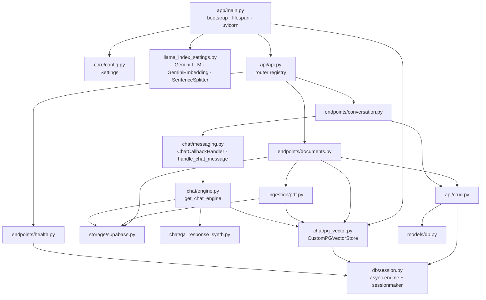
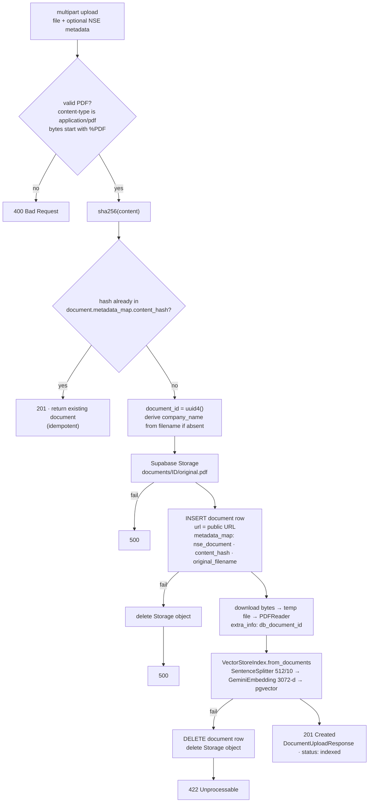

# Fincite · Backend

> **Agentic RAG service for Indian / NSE annual reports** — FastAPI · LlamaIndex · Google Gemini · Supabase (PostgreSQL + pgvector + Storage).

[](pyproject.toml)
[](app/main.py)
[](app/chat/engine.py)
[](app/db/session.py)
[](app/chat/pg_vector.py)
[](pyproject.toml)
[](tests)

This service owns everything behind the `/api` prefix: document ingestion, vector indexing, conversation state, and the streaming reasoning engine. The product context lives in the [root README](../README.md); this document is the engineering deep-dive.

---

## Contents

1. [Responsibilities](#1-responsibilities)
2. [Architecture](#2-architecture)
3. [The reasoning harness](#3-the-reasoning-harness)
4. [Ingestion pipeline](#4-ingestion-pipeline)
5. [Streaming protocol (SSE)](#5-streaming-protocol-sse)
6. [Data model & migrations](#6-data-model--migrations)
7. [Process model & boot sequence](#7-process-model--boot-sequence)
8. [API reference](#8-api-reference)
9. [Configuration](#9-configuration)
10. [Directory structure](#10-directory-structure)
11. [Getting started](#11-getting-started)
12. [Scripts](#12-scripts)
13. [Testing](#13-testing)
14. [Operational notes](#14-operational-notes)
15. [Known limitations & next steps](#15-known-limitations--next-steps)

---

## 1. Responsibilities

| Concern | Module | One-liner |
|---|---|---|
| HTTP surface | `app/api/` | Typed FastAPI routers for documents, conversations, health |
| Ingestion | `app/ingestion/pdf.py` · `app/storage/supabase.py` | PDF → Storage → page-labelled nodes → embeddings → pgvector |
| Reasoning | `app/chat/engine.py` · `app/chat/qa_response_synth.py` | ReAct agent → sub-question engine → per-document retrieval |
| Streaming | `app/chat/messaging.py` · `app/api/endpoints/conversation.py` | LlamaIndex callbacks → `anyio` channel → Server-Sent Events |
| Persistence | `app/models/` · `app/api/crud.py` · `alembic/` | SQLAlchemy 2 async models, CRUD, versioned migrations |
| Vector store | `app/chat/pg_vector.py` | `PGVectorStore` subclass sharing the app's connection pool |
| Configuration | `app/core/config.py` | `pydantic-settings` with URL / log-level / CORS validators |
| Lifecycle | `app/main.py` | One-shot bootstrap, per-worker lifespan, uvicorn entrypoint |

---

## 2. Architecture

### 2.1 Layered view

```
┌────────────────────────────────────────────────────────────────────────────────┐
│  Transport        FastAPI routers · CORS · OpenAPI · sse-starlette             │
├────────────────────────────────────────────────────────────────────────────────┤
│  Application      endpoints/documents.py   endpoints/conversation.py          │
│                   (upload orchestration)   (SSE publisher, message assembly)   │
├────────────────────────────────────────────────────────────────────────────────┤
│  Domain           chat/engine.py  chat/messaging.py  chat/qa_response_synth.py │
│                   ingestion/pdf.py  chat/utils.py  chat/constants.py           │
├────────────────────────────────────────────────────────────────────────────────┤
│  Infrastructure   api/crud.py  chat/pg_vector.py  storage/supabase.py          │
│                   db/session.py  llama_index_settings.py                       │
├────────────────────────────────────────────────────────────────────────────────┤
│  External         PostgreSQL + pgvector · Supabase Storage · Google Gemini     │
└────────────────────────────────────────────────────────────────────────────────┘
```

### 2.2 Dependency flow



### 2.3 Key third-party building blocks

| Package | Pinned | Role |
|---|---|---|
| `fastapi` / `pydantic` / `pydantic-settings` | 0.115.11 / 2.9.2 / 2.8.1 | API framework, schemas, settings |
| `sse-starlette` | 1.6.5 | `EventSourceResponse` for streaming |
| `sqlalchemy[asyncio]` / `asyncpg` / `alembic` | 2.0.19 / 0.29.0 / 1.11.2 | Async ORM, driver, migrations |
| `pgvector` / `llama-index-vector-stores-postgres` | 0.3.6 / 0.4.2 | Vector column type + LlamaIndex store |
| `llama-index-core` | 0.12.23 | Agent, query engines, callbacks, node parser |
| `llama-index-llms-gemini` / `llama-index-embeddings-gemini` | 0.5.0 / 0.3.2 | Gemini adapters |
| `llama-index-readers-file` / `pypdf` | 0.4.6 / 5.3.1 | PDF parsing with page labels |
| `supabase` | 2.16.0 | Storage client (service-role, server-side only) |
| `nltk` | 3.9.1 | Sentence tokenizer behind `SentenceSplitter` |
| `sentry-sdk[fastapi]` | 1.29.2 | Optional error tracking |

---

## 3. The reasoning harness

Everything below is in [`app/chat/engine.py`](app/chat/engine.py) unless stated otherwise.

### 3.1 Topology

```
conversation.documents ──▶ build_doc_id_to_index_map()
                                │  VectorStoreIndex.from_vector_store(pgvector)  (per doc)
                                │  └─ fallback: fetch PDF from Storage → re-index
                                ▼
                     index_to_query_engine(doc_id, index)
                                │  similarity_top_k = 3
                                │  MetadataFilters[ExactMatchFilter(db_document_id == doc_id)]
                                ▼
                     QueryEngineTool × N  (name = doc UUID, description from NSE metadata)
                                ▼
                     SubQuestionQueryEngine
                                │  question_gen      = LLMQuestionGenerator(Gemini)
                                │  response_synth    = get_custom_response_synth()  ← QA + Refine prompts
                                │  use_async         = True   (sub-questions fan out concurrently)
                                ▼
                     QueryEngineTool "document_question_engine"   (the agent's only tool)
                                ▼
                     ReActAgent.from_tools(
                         llm            = Gemini(GEMINI_CHAT_LLM_NAME),
                         chat_history   = get_chat_history(conversation.messages),
                         context        = SYSTEM_MESSAGE.format(doc_titles, curr_date),
                         max_iterations = 6,
                         callback_manager = CallbackManager([ChatCallbackHandler]),
                     )
```

### 3.2 Why it is shaped this way

| Decision | Rationale |
|---|---|
| **Per-document tools with metadata filters** instead of one big index | Guarantees retrieval isolation: a question about Reliance can never be answered with a TCS chunk. The tool *description* (e.g. `Annual report for Reliance Industries (RELIANCE), financial year 2025 (exchange: NSE).`) is how the LLM routes sub-questions. Built by [`chat/utils.py`](app/chat/utils.py) with safe fallbacks to filename when metadata is sparse. |
| **`SubQuestionQueryEngine` between the agent and the tools** | Multi-document questions ("compare A and B") are decomposed into one sub-question per document and executed concurrently. Synthesis happens once, with all evidence in view. |
| **A single top-level tool for the agent** | Keeps the ReAct loop simple and deterministic: the agent decides *whether* to research, the sub-question engine decides *where*. The system prompt and the per-message preamble both nudge the agent to use the tool for any financial question. |
| **`max_iterations = 6`** | Enough for reason → tool → observe → (optionally retry) → answer, while bounding latency and cost. |
| **`similarity_top_k = 3` per document, chunk 512 / overlap 10** | Financial prose is dense; three 512-token windows per document per sub-question keeps context tight for a Flash-class model and leaves room for multi-document synthesis. Constants live in [`chat/constants.py`](app/chat/constants.py). |
| **Prompt redundancy** | The system prompt ([`constants.SYSTEM_MESSAGE`](app/chat/constants.py)), the QA prompt and the Refine prompt ([`qa_response_synth.py`](app/chat/qa_response_synth.py)) all restate: use tools first · preserve units (₹ Crore / ₹ Lakh / USD Mn) · state the financial year · cite pages · never fabricate · decline off-topic. |
| **Chat history hygiene** | `get_chat_history()` drops messages with empty content or non-`SUCCESS` status and sorts by `created_at`, so a failed generation never poisons the next turn. Covered by 7 unit tests. |
| **`nest_asyncio.apply()`** | LlamaIndex's sub-question engine runs nested event loops when `use_async=True`; the patch is applied once at import. |

### 3.3 Observability via callbacks

[`chat/messaging.py`](app/chat/messaging.py) defines `ChatCallbackHandler(BaseCallbackHandler)`:

- Ignores noisy `CHUNKING` and `NODE_PARSING` events.
- On every other event start/end, schedules an async send of a `StreamedMessageSubProcess { source, event_id, has_ended, metadata_map }` onto an `anyio` memory channel.
- For `SUB_QUESTION` events it serialises the `SubQuestionAnswerPair` into `schema.QuestionAnswerPair { question, answer, citations[] }`, where each `Citation` is `{ document_id, page_number, text, score }` — built from the node's `page_label` and the `db_document_id` stamped at ingestion.
- Streamed tokens are forwarded as `StreamedMessage { content }` with the **cumulative** text.

The SSE publisher in [`endpoints/conversation.py`](app/api/endpoints/conversation.py) folds these into a single growing `Message` object keyed by `event_id` (so a start/end pair updates one sub-process row rather than creating two).

---

## 4. Ingestion pipeline

Entry point: `POST /api/document/upload` → [`endpoints/documents.py`](app/api/endpoints/documents.py) → [`ingestion/pdf.py`](app/ingestion/pdf.py).



**Metadata captured per document** (`schema.NSEDocumentMetadata`, stored under `metadata_map["nse_document"]`):

| Field | Type | Default |
|---|---|---|
| `company_name` | `str` | derived from filename (`reliance-ar-2025.pdf` → `Reliance Ar 2025`) |
| `company_symbol` | `str?` | — |
| `document_type` | `annual_report` · `financial_results` · `corporate_filing` · `investor_presentation` · `other` | `annual_report` |
| `financial_year` | `str?` | — |
| `report_date` | `datetime?` | — |
| `exchange` | `str` | `NSE` |
| `original_filename` | `str?` | upload filename |

**Properties worth noting**

- **Idempotent by content.** Re-uploading the same bytes returns the existing record — no duplicate vectors, no duplicate storage.
- **Transactional in effect.** Any failure after the Storage write unwinds both Storage and DB, so `GET /document/` only ever lists queryable documents.
- **Page provenance is preserved end-to-end.** `PDFReader` emits one LlamaIndex `Document` per page with `page_label`; the splitter keeps that metadata on every chunk; citations read it back.
- **Synchronous.** Indexing runs inside the request. Fine for typical filings; very large PDFs should move to a background job (see §15).

---

## 5. Streaming protocol (SSE)

```
GET /api/conversation/{conversation_id}/message?user_message=<urlencoded>
Accept: text/event-stream
```

### 5.1 Event shape

Every event's `data` is a **complete JSON `Message` snapshot** — not a delta. Clients simply replace their local copy on each event.

```jsonc
{
  "id": "0d6d…",                          // assistant message id (stable across the stream)
  "conversation_id": "9b1e…",
  "role": "assistant",
  "status": "PENDING",                    // PENDING while streaming → SUCCESS | ERROR on the final event
  "content": "Consolidated revenue for FY2025 was ₹ 9,64,693 Crore …",   // grows monotonically
  "sub_processes": [
    {
      "id": null,                          // assigned when persisted (final event)
      "message_id": "0d6d…",
      "source": "constructed_query_engine",
      "status": "FINISHED",
      "metadata_map": null
    },
    {
      "message_id": "0d6d…",
      "source": "sub_question",
      "status": "FINISHED",                // PENDING until the event's end callback fires
      "metadata_map": {
        "sub_question": {
          "question": "What was Reliance Industries' consolidated revenue in FY2025?",
          "answer": "… ₹ 9,64,693 Crore (FY2025) …",
          "citations": [
            {
              "document_id": "3f2a…",
              "page_number": 212,
              "text": "Revenue from operations … 9,64,693 …",
              "score": 0.81
            }
          ]
        }
      }
    }
  ],
  "created_at": null,
  "updated_at": null
}
```

### 5.2 Lifecycle

| Phase | What the client sees |
|---|---|
| Engine build | one `sub_process` with `source = constructed_query_engine` |
| Agent reasoning | `sub_process` rows for `agent_step`, `llm`, `function_call`, `templating` … (`source` values mirror LlamaIndex `CBEventType` plus `constructed_query_engine` / `sub_questions`) |
| Sub-question fan-out | one `sub_question` row per generated sub-question, carrying question → answer → citations once finished |
| Retrieval / synthesis | `retrieve`, `synthesize`, `embedding` rows |
| Token stream | `content` grows on each event, `status` stays `PENDING` |
| Completion | **last event** is the persisted message re-read from the DB — `status` is `SUCCESS` or `ERROR`, sub-processes now have real `id`s and timestamps |

If the agent produces no text, the server emits a graceful fallback sentence rather than an empty message. Errors inside the agent task are logged, the message is stored with `status = ERROR`, and the stream still terminates cleanly.

### 5.3 Consuming it

```bash
# curl keeps the connection open and prints each event as it arrives
curl -N "http://localhost:8000/api/conversation/$CID/message?user_message=$(python -c 'import urllib.parse;print(urllib.parse.quote("Compare FY2025 and FY2024 net profit"))')"
```

```js
// browser
const es = new EventSource(`${API}/api/conversation/${cid}/message?user_message=${encodeURIComponent(q)}`);
es.onmessage = (e) => {
  const msg = JSON.parse(e.data);        // full Message snapshot
  render(msg);
  if (msg.status !== "PENDING") es.close();
};
```

Need it without SSE (e.g. in Swagger UI)? `GET /conversation/{id}/test_message` drains the same stream server-side and returns only the final `Message`.

---

## 6. Data model & migrations

### 6.1 Tables

All tables inherit `id UUID PK (uuid_generate_v4)`, `created_at`, `updated_at` from [`models/base.py`](app/models/base.py); table names are the lower-cased class names.

| Table | Columns (beyond base) | Notes |
|---|---|---|
| `conversation` | — | Root aggregate |
| `document` | `url` (unique) · `metadata_map` JSONB | `metadata_map` holds `nse_document`, `content_hash`, `original_filename` |
| `conversationdocument` | `conversation_id` FK · `document_id` FK (both indexed) | Many-to-many scope |
| `message` | `conversation_id` FK · `content` · `role` (PG enum `user`/`assistant`) · `status` (PG enum `PENDING`/`SUCCESS`/`ERROR`) | |
| `messagesubprocess` | `message_id` FK · `source` (PG enum of `CBEventType` ∪ custom) · `status` (`PENDING`/`FINISHED`) · `metadata_map` JSONB | Persisted reasoning trace |
| `data_pg_vector_store` | `id` · `text` · `metadata_` JSONB · `node_id` · `embedding vector(3072)` | Managed by LlamaIndex's `PGVectorStore` (prefix `data_` is added automatically) |

`MessageSubProcessSourceEnum` is generated at import time from `llama_index.core.callbacks.schema.CBEventType` plus two custom members, so the DB enum must be migrated whenever LlamaIndex adds event types — which is exactly what three of the migrations do.

### 6.2 Migrations

| Revision | Purpose |
|---|---|
| `477cee72edc4` | `CREATE EXTENSION "uuid-ossp"`; `conversation`, `message`, `messagesubprocess` |
| `c008bb4f3f48` | Extend sub-process `source` enum; add `status` + `metadata_map` |
| `90a1d6a26343` | `document`, `conversationdocument` |
| `1b0b616e08c6` | Replace enum values (rename-type/retype-column/drop pattern) |
| `873c0c4616ea` | Foreign-key indices |
| `663b3fea3024` | Add `AGENT_STEP`, `FUNCTION_CALL`, `RERANKING`, `TEMPLATING`, `EXCEPTION` … |

`alembic/env.py` reads `DATABASE_URL` from settings and runs migrations through the async engine. Boot **refuses to start** if the database is not at head (`check_current_head`), which turns a forgotten migration into a loud, early failure instead of a runtime 500.

```bash
uv run alembic upgrade head                 # apply
uv run alembic revision --autogenerate -m "…"   # after editing models/db.py
```

---

## 7. Process model & boot sequence

```
uv run start  ─▶  app.main.start()
                   ├─ _setup_logging(LOG_LEVEL)
                   ├─ _setup_sentry()                       (no-op without SENTRY_DSN)
                   ├─ asyncio.run(_bootstrap(release_connections=True))
                   │    ├─ check_database_connection()       up to 30 × 1 s retries
                   │    ├─ check_current_head()              Alembic at head, else raise
                   │    ├─ vector_store.run_setup()          CREATE EXTENSION vector; create tables
                   │    ├─ split_by_sentence_tokenizer()     pre-download NLTK punkt
                   │    └─ vector_store.close()              parent serves no traffic
                   ├─ os.environ["FINCITE_BOOTSTRAP_DONE"] = "1"
                   └─ uvicorn.run("app.main:app", host=0.0.0.0, port=8000,
                                  workers=BACKEND_WORKERS, reload=(LOG_LEVEL == "DEBUG"))
                          │
                          └─ per worker: lifespan()
                               ├─ _bootstrap() only if FINCITE_BOOTSTRAP_DONE != "1"
                               │   (i.e. when launched as `uvicorn app.main:app` directly)
                               ├─ await asyncio.to_thread(_setup_llama_index_settings)
                               │   (Gemini constructor does a blocking metadata call)
                               ├─ vector_store.ensure_initialized()   pools only, no DDL
                               └─ … serve …  → on shutdown: vector_store.close()
```

**Connection pooling.** [`db/session.py`](app/db/session.py) creates one async engine per process (`pool_size=4`, `max_overflow=4`, `pool_pre_ping`, `pool_recycle=3600`, `pool_timeout=120`). [`chat/pg_vector.py`](app/chat/pg_vector.py) overrides `PGVectorStore._connect()` so the vector store **reuses that same engine and sessionmaker** instead of opening a second pool — important on Supabase's connection-limited tiers. DDL is suppressed in the subclass and run exactly once in `run_setup()`.

---

## 8. API reference

Base path `/api`. Interactive docs: `/api/docs` (Swagger) · `/api/redoc` · `/api/openapi.json`.

### Health

| | |
|---|---|
| `GET /health/` | Executes `SELECT 1` → `{ "status": "alive" }` |

### Documents

<details>
<summary><code>POST /document/upload</code> — upload & index a PDF → <code>201</code></summary>

**Request** `multipart/form-data`

| Field | Required | Example |
|---|---|---|
| `file` | ✅ | `reliance-annual-report-2025.pdf` |
| `company_name` | | `Reliance Industries` |
| `company_symbol` | | `RELIANCE` |
| `financial_year` | | `2025` |
| `document_type` | | `annual_report` (default) · `financial_results` · `corporate_filing` · `investor_presentation` · `other` |
| `exchange` | | `NSE` (default) |

```bash
curl -X POST http://localhost:8000/api/document/upload \
  -F "file=@reliance-annual-report-2025.pdf" \
  -F "company_name=Reliance Industries" -F "company_symbol=RELIANCE" \
  -F "financial_year=2025" -F "document_type=annual_report"
```

**Response** `201`
```json
{
  "id": "3f2a4c1e-…",
  "url": "https://<project>.supabase.co/storage/v1/object/public/annual-reports/documents/3f2a4c1e-…/original.pdf",
  "metadata_map": {
    "nse_document": {
      "company_name": "Reliance Industries", "company_symbol": "RELIANCE",
      "document_type": "annual_report", "financial_year": "2025",
      "report_date": null, "exchange": "NSE",
      "original_filename": "reliance-annual-report-2025.pdf"
    },
    "content_hash": "9c1d…",
    "original_filename": "reliance-annual-report-2025.pdf"
  },
  "status": "indexed",
  "created_at": "2026-10-14T10:12:03.412Z",
  "updated_at": "2026-10-14T10:12:03.412Z"
}
```

| Status | Meaning |
|---|---|
| `201` | Indexed (or duplicate — existing document returned) |
| `400` | Not a PDF / empty file |
| `422` | Stored but unparseable; everything rolled back |
| `500` | Storage or DB failure |
</details>

<details>
<summary><code>GET /document/</code> · <code>GET /document/{id}</code></summary>

```bash
curl "http://localhost:8000/api/document/"                               # all
curl "http://localhost:8000/api/document/?document_ids=<uuid>&document_ids=<uuid>"
curl "http://localhost:8000/api/document/<uuid>"
```
Returns `Document[]` / `Document` (`id`, `url`, `metadata_map`, timestamps). `404` when nothing matches.
</details>

### Conversations

<details>
<summary><code>POST /conversation/</code> — create a conversation over documents</summary>

```bash
curl -X POST http://localhost:8000/api/conversation/ \
  -H "Content-Type: application/json" \
  -d '{"document_ids": ["3f2a4c1e-…", "7b9d0e22-…"]}'
```
Validates that every id exists (`404` listing the missing ones otherwise). Returns the full `Conversation { id, messages: [], documents: [...] }`.
</details>

<details>
<summary><code>GET /conversation/{id}</code> · <code>DELETE /conversation/{id}</code></summary>

`GET` returns the conversation with **all messages and their sub-process traces** (eager-loaded with `joinedload` + `subqueryload`, so there is no N+1). `DELETE` returns `204`, `404` if unknown.
</details>

<details>
<summary><code>GET /conversation/{id}/message?user_message=…</code> — <b>SSE</b> stream</summary>

See [§5 Streaming protocol](#5-streaming-protocol-sse). The user message is persisted alongside the assistant message once the stream completes.
</details>

<details>
<summary><code>GET /conversation/{id}/test_message?user_message=…</code> — non-streamed</summary>

Consumes the SSE stream server-side and returns the final `Message`. Intended for Swagger UI and smoke tests.
</details>

---

## 9. Configuration

Settings are declared in [`core/config.py`](app/core/config.py) and loaded from the environment / `.env` (see [`.env.example`](.env.example)).

| Variable | Required | Default | Notes |
|---|---|---|---|
| `DATABASE_URL` | ✅ | — | Any `postgres://` / `postgresql://` URL; rewritten to `postgresql+asyncpg://`. Alembic check uses a `psycopg2` variant internally. |
| `GOOGLE_API_KEY` | ✅ | — | Exported to `os.environ` for the Gemini SDK |
| `SUPABASE_URL` | ✅* | `""` | *Required for upload/ingest; validated lazily |
| `SUPABASE_SERVICE_ROLE_KEY` | ✅* | `""` | Never leaves the server |
| `SUPABASE_STORAGE_BUCKET` | | `annual-reports` | Must exist. `get_document_url()` uses the **public URL** pattern; use a public bucket or swap in signed URLs. |
| `GEMINI_CHAT_LLM_NAME` | | `models/gemini-1.5-flash` | Any Gemini chat model |
| `GEMINI_EMBEDDING_MODEL_NAME` | | `models/gemini-embedding-001` | Change together with `VECTOR_STORE_EMBED_DIM` |
| `VECTOR_STORE_TABLE_NAME` | | `pg_vector_store` | Physical table becomes `data_pg_vector_store` |
| `VECTOR_STORE_EMBED_DIM` | | `3072` | Must match the embedding model (unit-tested) |
| `BACKEND_WORKERS` | | `4` | Ignored when reload is on |
| `BACKEND_CORS_ORIGINS` | | `[]` | JSON list `["http://localhost:5173"]` or comma-separated |
| `LOG_LEVEL` | | `INFO` | `DEBUG` ⇒ uvicorn `--reload`, verbose agent/sub-question traces |
| `SENTRY_DSN` | | `None` | 10 % trace sampling when set |
| `PROJECT_NAME` / `API_PREFIX` | | `fincite` / `/api` | |

---

## 10. Directory structure

```
backend/
├── app/
│   ├── main.py                     # start(), _bootstrap(), lifespan(), FastAPI app
│   ├── schema.py                   # Pydantic: Document, Conversation, Message, MessageSubProcess,
│   │                               #   Citation, QuestionAnswerPair, NSEDocumentMetadata, enums
│   ├── llama_index_settings.py     # Settings.llm / embed_model / node_parser
│   ├── core/config.py              # Settings (pydantic-settings) + validators
│   ├── api/
│   │   ├── api.py                  # include_router × 3
│   │   ├── crud.py                 # fetch/create/delete for conversations, messages, documents
│   │   ├── deps.py                 # get_db() async session dependency
│   │   └── endpoints/
│   │       ├── conversation.py     # CRUD + SSE publisher + test_message
│   │       ├── documents.py        # upload orchestration + list/get
│   │       └── health.py
│   ├── chat/
│   │   ├── engine.py               # harness: indices → tools → sub-question engine → ReAct agent
│   │   ├── messaging.py            # ChatCallbackHandler, StreamedMessage*, handle_chat_message
│   │   ├── qa_response_synth.py    # domain QA + Refine prompt templates
│   │   ├── pg_vector.py            # CustomPGVectorStore (shared pool, one-shot DDL), singleton
│   │   ├── constants.py            # DB_DOC_ID_KEY, SYSTEM_MESSAGE, chunk size/overlap
│   │   └── utils.py                # build_title_for_document / build_description_for_document
│   ├── ingestion/pdf.py            # load_pdf_from_bytes, ingest_document
│   ├── storage/supabase.py         # client singleton, upload/download/delete/get_document_url
│   ├── models/
│   │   ├── base.py                 # DeclarativeBase with uuid pk + timestamps + auto tablename
│   │   └── db.py                   # Document, Conversation, ConversationDocument, Message, MessageSubProcess
│   └── db/
│       ├── session.py              # create_async_engine + async_sessionmaker
│       ├── base.py                 # model registry for Alembic autogenerate
│       └── wait_for_db.py          # retry loop
├── alembic/                        # env.py (async), 6 revisions
├── scripts/                        # chat_llama.py, build_vector_tables.py, dedupe_vector_store.py, upsert_document.py
├── tests/
│   ├── conftest.py                 # sets env vars so modules import without real services
│   └── app/
│       ├── chat/test_engine.py     # chat-history hygiene × 7, embed-dim guard × 1
│       └── test_refactored.py      # metadata, storage, ingestion, upload endpoint, health × 7
├── Dockerfile                      # python:3.11-slim + uv, cached dependency layer, NLTK prefetch
├── docker-compose.yml              # backend + ankane/pgvector for local dev
├── pyproject.toml · uv.lock        # hatchling build, `start` console script, dev group
├── .env.example · .dockerignore
└── README.md
```

---

## 11. Getting started

### 11.1 Local (recommended for development)

```bash
# 0. Python 3.11 + uv (https://docs.astral.sh/uv/)
cd backend
cp .env.example .env
#    → DATABASE_URL            Supabase Postgres URL (or any Postgres with pgvector)
#    → SUPABASE_URL / SUPABASE_SERVICE_ROLE_KEY / SUPABASE_STORAGE_BUCKET
#    → GOOGLE_API_KEY          https://aistudio.google.com/apikey
#    → BACKEND_CORS_ORIGINS    e.g. ["http://localhost:5173"] for the Vite dev server

uv sync                        # resolves from uv.lock, includes dev group
uv run alembic upgrade head    # schema
uv run start                   # bootstrap → http://localhost:8000/api/docs
```

Supabase one-time setup: create the Storage bucket named in `SUPABASE_STORAGE_BUCKET` (public, or adapt `get_document_url` to signed URLs). The `vector` and `uuid-ossp` extensions are created automatically on first boot / first migration.

### 11.2 Docker

```bash
cd backend
cp .env.example .env           # Supabase Storage + Gemini creds still come from here
docker compose up --build      # backend :8000 + local pgvector (DATABASE_URL overridden in compose)
docker compose exec fincite-backend .venv/bin/alembic upgrade head   # first run only
```

The image installs dependencies from `uv.lock` in a cached layer, pre-downloads NLTK data, then copies the source — code changes don't invalidate the dependency layer.

> The compose file bind-mounts `./` into `/app` for live reload (`LOG_LEVEL=DEBUG`). That mount also shadows the image's `/app/.venv`, so either run `uv sync` on the host first (Linux) or remove the `volumes:` entry for a fully self-contained container.

### 11.3 Smoke test

```bash
curl -s localhost:8000/api/health/                       # {"status":"alive"}
curl -s -X POST localhost:8000/api/document/upload -F file=@some-annual-report.pdf | jq .id
curl -s -X POST localhost:8000/api/conversation/ -H 'content-type: application/json' \
     -d '{"document_ids":["<id>"]}' | jq -r .id
curl -N "localhost:8000/api/conversation/<cid>/message?user_message=Summarise%20the%20key%20risks"
```

---

## 12. Scripts

| Script | What it does |
|---|---|
| `scripts/chat_llama.py` | Interactive terminal client over the HTTP API: `pick_docs` → `fetch` / `select` / `select_id` → `finish` → `create` → `message <q>` (renders the SSE stream) → `detail` / `delete`. `--base_url` defaults to `http://localhost:8000`. |
| `scripts/build_vector_tables.py` | Runs `CustomPGVectorStore.run_setup()` out-of-band (extension + tables). |
| `scripts/dedupe_vector_store.py` | Finds duplicate chunks (same `text`, `page_label`, `db_document_id`) in `data_pg_vector_store`; `--dry_run` to preview, confirms before deleting. |
| `scripts/upsert_document.py` | Upserts a `document` row by URL with empty metadata (legacy helper for externally hosted PDFs). |

> The last three use [`fire`](https://github.com/google/python-fire) for their CLI, which is **not** in `pyproject.toml` — run them with `uv run --with fire python scripts/<name>.py …`.

---

## 13. Testing

```bash
cd backend
uv run pytest -q           # 15 passed in ~6 s
uv run pytest -v tests/app/chat/test_engine.py
```

| File | Coverage |
|---|---|
| `tests/app/chat/test_engine.py` | `get_chat_history` — ordering, consecutive same-role turns, empty input, `ERROR` filtering (user and assistant), whitespace stripping, unpaired trailing user message; `get_vector_store_singleton` — asserts `embed_dim == 3072` |
| `tests/app/test_refactored.py` | `NSEDocumentMetadata` parsing & defaults; Supabase storage helpers (client singleton, upload/download/delete paths); `ingest_document` flow (download → parse → index → `set_index_id`); upload endpoint happy path and non-PDF rejection; health endpoint |

Tests are **hermetic**: `conftest.py` seeds `DATABASE_URL`, `GOOGLE_API_KEY` and `SUPABASE_*` with dummy values before any app module is imported, and external calls are patched with `unittest.mock`. No Postgres, no network.

Linting: `uv run pylint app`.

---

## 14. Operational notes

- **Startup is fail-fast.** DB unreachable after 30 s, migrations behind head, or a missing required env var all abort before uvicorn binds.
- **Idempotent bootstrap.** `_bootstrap()` can run many times safely; the `FINCITE_BOOTSTRAP_DONE` env flag merely avoids repeating it in each worker.
- **Logging.** Root logger with thread name + level; `LOG_LEVEL=DEBUG` also flips LlamaIndex `verbose=True` for the agent and sub-question engine so every thought/action/observation is printed.
- **Sentry.** Initialised only when `SENTRY_DSN` is set; `traces_sample_rate=0.1`.
- **CORS.** Credentials allowed, all methods/headers, origins from `BACKEND_CORS_ORIGINS` (`*` accepted).
- **Secrets.** The Supabase service-role key is only ever used server-side; `.dockerignore` excludes `.env*` from images.
- **Back-pressure.** The SSE publisher uses a bounded `anyio` channel (100 items); callback sends after the client disconnects are detected and dropped, not raised.

---

## 15. Known limitations & next steps

| Limitation | Planned direction |
|---|---|
| Upload indexes synchronously; a 400-page filing can take a while and ties up a worker | Background job + progress events on the document (the frontend already models `parsing → chunking → embedding → indexing`) |
| Dense retrieval only | Hybrid BM25 + dense fusion, cross-encoder rerank stage, exposed as `RERANKING` sub-process (enum value already migrated) |
| No authentication or tenancy | Supabase Auth JWT verification, per-user documents and conversations |
| `document.url` relies on a public bucket | Signed URLs with short TTL from `get_document_url` |
| Gemini SDK (`google-generativeai`) is deprecated upstream | Migrate adapters to `google-genai` when LlamaIndex integrations land |
| No eval suite | Golden Q&A set over public NSE filings; faithfulness / citation-precision metrics in CI |
| CLI scripts depend on undeclared `fire` | Add to the `dev` dependency group |
