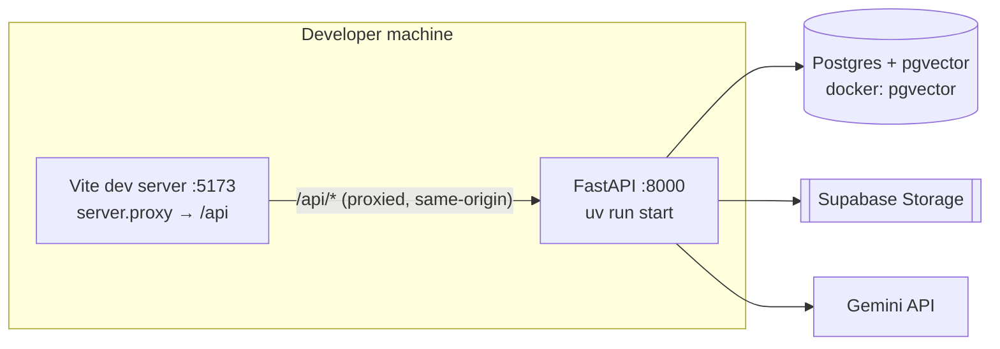
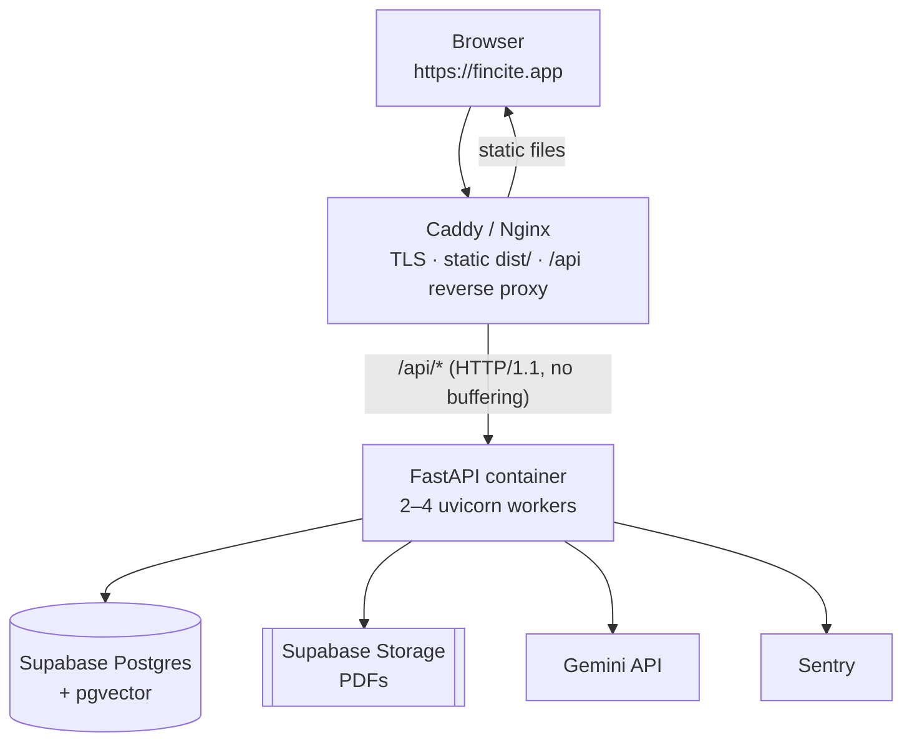

# Fincite — Connect the frontend to the backend, and ship it

> **Status:** M0 ✅ done · M1 ✅ done · M2–M6 open · **Date:** 2026-10-26 · **Branch:** `arena/006dcca4-fincitee`
> **Scope:** make the real FastAPI backend drive the real React UI, then deploy a usable product with a
> markedly richer frontend (and the backend work that richness requires).
> **Audience:** whoever executes the plan (human or agent). Every claim below was checked against the
> code in this checkout; file references are the source of truth.

---

## Implementation log

| Milestone | State | Landed |
|---|---|---|
| **M0 — Baseline green** | ✅ done | typecheck fixed (runaway comment + unused import); `VITE_USE_MOCK` / `VITE_API_URL` env-driven with same-origin default; Vite dev proxy + `host 0.0.0.0` + `allowedHosts`; `typecheck`/`dev:mock`/`dev:real`/`build:demo` scripts; `frontend/.env.example` (and `.gitignore` un-ignored it); `docker-compose.yml` port fix + healthcheck; `.github/workflows/ci.yml` |
| **M1 — API a real client can use** | ✅ done | 4 migrations (`a1f0c3d5b7e9`, `b2e4d6f8a0c1`, `c3a5e7b9d1f2`, `d4b6f8c0e2a3`) + matching models; background ingestion (`app/ingestion/jobs.py`); documents: 202 upload, enriched list/`[]`, `DELETE`, `reindex`, `/file`; conversations: optional scope, `GET /` index, `PATCH`, cascade delete; `POST /message` streaming with durable partials; `message.sources`; trail labels + durations; `/health/` v2 + `/api/config/`; CWD-safe bootstrap + stale-ingest sweep; contract tests (52 passing) |
| **M2 — Frontend actually connected** | next | `wire.ts` mappers + fetch/`ReadableStream` transport + thread rehydration |
| **M3 — UX richness** | open | PDF viewer, trail 2.0, compare mode, palette, upload metadata form |
| **M4 — Auth & cost control** | open | Supabase JWT, per-user scoping, quotas |
| **M5 — Deployment** | open | one-origin Caddy + CI/CD + `scripts/smoke.sh` |

Deviations from the plan as written, and why:

* **`DocumentStatusEnum` members are lowercase** (`uploaded`, not `UPLOADED`). SQLAlchemy persists the
  enum *name*, so name ≠ value would have stored a different string than the API advertises. Lowercase
  names == values keeps migration, DB, OpenAPI and UI identical.
* **`message.sources` is not back-filled by SQL.** Old messages still carry citations inside
  `sub_processes[].metadata_map`; `citations_from_sub_processes()` derives `sources` at read/write time,
  so existing threads render correctly without a data migration. (New messages persist it directly.)
* **No `openapi-typescript` / `vitest` / `pdfjs-dist` yet** — all deferred to the milestone that needs
  them, pending sign-off.
* **Ingestion is process-local** (`asyncio.create_task` + `Semaphore(1)`), not a queue. The interface is
  `jobs.schedule_ingestion()` so a real queue can replace it without touching the endpoint.

---

## 0. What "done" means

The plan is finished when all six statements are true:

1. `docker compose up` (or one click on the chosen host) gives a **single URL** where a stranger can sign in,
   upload an NSE PDF, watch it index, ask a question, and read a cited answer.
2. Every screen is driven by **live API data** — no `ANSWER_BANK`, no `SEED_DOCUMENTS`, no fake pipeline timers.
   The mock transport survives only as an explicit demo mode (`VITE_USE_MOCK=1`).
3. Reloading the page restores threads and messages from the server (the UI is a view of the database,
   not of React state).
4. A citation opens the **actual PDF page** the number came from.
5. Uploads longer than 60 s are **survivable** (background indexing + progress), and a dropped SSE
   connection never loses an answer.
6. CI runs `pytest`, `tsc --noEmit` and `vite build` on every push, and a tagged release deploys itself.

Non-goals for this pass: hybrid BM25 reranking, multi-provider model abstraction, mobile app, teams/RBAC
beyond per-user libraries, and an evaluation harness (tracked in the existing README roadmap).

---

## 1. Where the code actually stands (audited)

The two halves are **not** near each other — they were built to different contracts. This is the single
biggest fact the plan has to respect: the frontend's "real" transport is a stub, and the backend lacks
roughly half of the reads/writes the UI assumes.

### 1.1 Frontend

| # | Finding | Evidence |
|---|---|---|
| F1 | `USE_MOCK` is **`false`** in source, while README says `true` and `AGENTS.md` says `true`. So the app currently makes real HTTP calls that cannot succeed. | `frontend/src/lib/api.ts:32`, README §6.3, AGENTS.md §14.B |
| F2 | `RealTransport` sends `?q=` but the API expects `?user_message=`. | `api.ts:417` vs `conversation.py:78` |
| F3 | `RealTransport` listens for named events (`sub_process`, `delta`, `done`); the backend emits **unnamed** events, each a full `Message` snapshot. | `api.ts:420-433` vs `conversation.py:174` |
| F4 | `POST /api/conversation/` is called with `{title, document_scope}`; the API requires `{document_ids: UUID[]}` (required field). | `api.ts:399`, `store.tsx:308` vs `schema.py:207` |
| F5 | `EventSource` cannot send `Accept`/`Authorization` headers, cannot `POST`, and has no abort-with-reason — it cannot carry the eventual auth token. | `api.ts:414` |
| F6 | No conversation list, no rehydrate: threads live only in React state; `api.getConversation` is exported but unused. | `store.tsx:335`, docs/agents/modules/frontend.md §2 |
| F7 | Types do not typecheck: an unterminated `/**` at the top of `types.ts` swallows `NSEDocumentType`, `DocumentStatus`, `DocumentMetadata`, `FinDocument`; `Sidebar.tsx` imports an unused `Activity`. 5 `tsc` errors. | `types.ts:1-4`, `Sidebar.tsx:3`, AGENTS.md §14.A |
| F8 | Type drift: UI `nse_symbol/fiscal_year/pages/file_size/period` vs API `company_symbol/financial_year/original_filename`; different doc-type and sub-process enums. | `types.ts:19-34` vs `schema.py:140-160` |
| F9 | `sources: Source[]` is expected per message; the API only carries citations **inside** `sub_process.metadata_map`. | `types.ts:76`, `schema.py:64-88` |
| F10 | Sub-process `name`/`detail`/`duration_ms` are expected; the API gives `source` (LlamaIndex `CBEventType`) + `status` (`PENDING`/`FINISHED`) + `metadata_map` + timestamps. | `types.ts:59-67`, `db.py:29-36` |
| F11 | Every token patch replaces the whole conversations array (O(n) renders per token, no batching). | `store.tsx:206-215` |
| F12 | Upload sends only `{name,size,type}` — no NSE metadata form, although the backend accepts it. | `store.tsx:135-150`, `documents.py:47-57` |
| F13 | No dev proxy; base URL defaults to `http://localhost:8000` from env at build time. Single-file build inlines it forever. | `vite.config.ts`, `api.ts:33` |

### 1.2 Backend

| # | Finding | Evidence |
|---|---|---|
| B1 | `ConversationCreate.document_ids` is **required**, so "new chat, then scope later" (what the UI does) yields `422`. | `schema.py:207` |
| B2 | No `title` column and no `GET /api/conversation/` list endpoint → thread sidebar cannot be server-backed. | `models/db.py:50-60`, `conversation.py` |
| B3 | `DELETE /conversation/{id}` raises an FK violation for any non-empty thread (no `ON DELETE CASCADE`). | `crud.py:57`, migration `477cee72edc4` |
| B4 | `GET /api/document/` returns **404** on an empty library — hostile to a polling client. | `documents.py:199` |
| B5 | No `DELETE /api/document/{id}`, no vector cleanup, no re-index path. | AGENTS.md §14.J |
| B6 | No way to fetch the PDF bytes for a viewer (only a public/signed URL string at upload time). | `storage/supabase.py:69+` |
| B7 | Indexing runs **inside** the upload request (minutes for a 300-page filing); no `status`/`progress`/`error` columns, so the UI's `parsing → chunking → embedding → indexing` pipeline cannot be real. | `documents.py:170-186`, AGENTS.md §14.I |
| B8 | SSE is a `GET` with the question in the query string (URL length + log hygiene), and messages are persisted only at the **end** — a disconnect loses the answer. | `conversation.py:70-120, 178-186` |
| B9 | Streaming concurrency is fragile: `async with send_chan` in two places, fire-and-forget `create_task` on callback events, reads private `send_chan._closed`. | `messaging.py:51,65,102`, `conversation.py:113,156` |
| B10 | `_bootstrap()` resolves `Config("alembic.ini")` relative to CWD → breaks when the container/workdir differs. | `main.py:89`, AGENTS.md §14.N |
| B11 | `/api/health/` returns `{"status":"alive"}` but the UI type expects `healthy｜degraded｜down`. | `health.py:16`, `types.ts:110` |
| B12 | No auth, no tenancy, no rate limiting — every endpoint is public and pays Gemini tokens. | AGENTS.md §14.Q |
| B13 | `docker-compose.yml` maps host 5433 → container **5433** (Postgres listens on 5432), no frontend/web/reverse-proxy service, obsolete `version: '3'`. | `docker-compose.yml` |
| B14 | No `.github/workflows` at all. | repo root |
| B15 | Chat model is `models/gemini-1.5-flash`; the 1.5 family is end-of-life. **Deployment blocker — verify before go-live.** Changing the *chat* model is free; changing the *embedding* model requires re-indexing (3072-dim lock). | `config.py:24`, `pyproject.toml` |

**Conclusion:** the integration is not a matter of flipping a flag. It is a contract-first project:
harden the API additively (M1), write a real client transport + mapper (M2), then spend the bulk of the
effort on UX (M3) on top of a stable contract.

---

## 2. Target architecture

### 2.1 Development



Same-origin via a Vite proxy removes CORS from the developer's life and makes the frontend's base URL
the empty string in dev **and** prod (`/api/...`).

### 2.2 Production (recommended: one origin)



Why one origin: no CORS maintenance, first-party cookies if you ever want them, SSE unaffected by
cross-site preflight, and the single-file frontend keeps working. The alternative (Vercel/Netlify
frontend + Fly/Railway/Render backend) is fine too — it just moves CORS, preview URLs and cookie policy
into your lap. Both are spelled out in §5.5.

---

## 3. Principles

1. **Contract first, UI second.** Freeze the HTTP + SSE contract in `docs/agents/API_REFERENCE.md`, then
   make both sides agree with a contract test. The UI should never have to guess a shape.
2. **Backend changes are additive.** Old endpoints keep working (`GET /message` stays) so nothing breaks
   mid-migration; new capabilities land as new routes/fields.
3. **The database is the UI's memory.** Threads, titles, scopes, messages, sub-processes, citations and
   document status all live server-side. LocalStorage is only for drafts and "last opened thread".
4. **Mocks are a product feature, not scaffolding.** Demo mode stays, driven by env, so the UI can be
   reviewed with no keys and no database.
5. **Every phase ends deployable.** No long-lived "integration branch" that only works on one laptop.
6. **No new frameworks without sign-off** (AGENTS.md §15). The plan flags each such decision explicitly:
   SSE client approach (hand-rolled), PDF viewer (`pdfjs-dist`), E2E tests (Playwright), OpenAPI→TS types
   (`openapi-typescript`).

---

## 4. Milestones at a glance

| Milestone | Outcome | Est. | Depends on |
|---|---|---|---|
| **M0 — Baseline green** | Typecheck passes, scripts/env/proxy sane, CI exists | 0.5–1 d | — |
| **M1 — API a real client can use** | Documents have lifecycle + delete + file bytes; conversations have title/list/patch/cascade; messages expose citations; streaming is POST + durable | 3–4 d | M0 |
| **M2 — Frontend actually connected** | `wire.ts` mappers, fetch-based SSE client, server-backed threads, uploads with metadata, no mocks by default | 3–4 d | M1 |
| **M3 — UX richness** | PDF viewer with page jump, live research trail, compare mode, command palette, polished states, mobile | 6–9 d | M2 |
| **M4 — Auth, tenancy, cost control** | Sign-in, per-user libraries/threads, quotas, rate limits | 3–4 d | M1 |
| **M5 — Deployment** | One-origin prod stack, CI/CD, migrations on release, smoke tests | 2–3 d | M1 (+M4 for public) |
| **M6 — Hardening & launch** | Observability, runbook, backups, load sanity, accessibility pass | 2 d | M5 |

Total ≈ **20–27 focused days**; M3 and M4 can run in parallel once M2 lands. If you must launch sooner,
the **"usable MVP"** line is M0 → M1 → M2 → M5 with auth deferred behind a private/beta deployment.

---

## 5. Phase detail

### M0 — Baseline green (0.5–1 day)

Cheap, unblocks everything, no product decisions needed.

- [ ] Close the runaway comment in `frontend/src/lib/types.ts:1-4`; delete the unused `Activity` import in
      `Sidebar.tsx`. Verify `npx tsc --noEmit` is clean. AGENTS.md §14.A calls this the root cause of all
      5 errors — confirm rather than assume.
- [ ] Make the transport mode explicit and env-driven:
      `export const USE_MOCK = import.meta.env.VITE_USE_MOCK === "1";`
      and add `VITE_API_URL` (default `""` = same origin) in a new `frontend/.env.example`.
- [ ] Add `frontend/vite.config.ts` dev proxy + real host binding:

```ts
export default defineConfig({
  plugins: [react(), tailwindcss(), viteSingleFile()],
  resolve: { alias: { "@": path.resolve(__dirname, "src") } },
  server: {
    host: "0.0.0.0",
    port: 5173,
    proxy: { "/api": { target: process.env.VITE_PROXY_TARGET ?? "http://localhost:8000", changeOrigin: true } },
  },
});
```

- [ ] npm scripts: `"typecheck": "tsc --noEmit"`, `"dev:mock": "VITE_USE_MOCK=1 vite"`,
      `"build:demo": "VITE_USE_MOCK=1 vite build"`. Update README §6.3 (it currently contradicts the code).
- [ ] Add `.github/workflows/ci.yml`: backend `uv sync --frozen && uv run pytest -q`; frontend
      `npm ci && npm run typecheck && npm run build`. (No new framework — plain Actions, satisfies §14.Q.)
- [ ] Fix `docker-compose.yml`: `5433:5432`, drop `version: '3'`, add a `healthcheck` on `db`.
- [ ] **Exit criteria:** CI green on `main`; `npm run dev` shows the mock UI; `npm run dev` with
      `VITE_USE_MOCK=0` fails loudly (not silently) against a stopped backend.

---

### M1 — Backend: an API a real client can use (3–4 days)

Goal: every read, write and stream the UI needs exists, is typed, and is tested. **Additive only.**

#### M1.1 Data model changes (one Alembic revision per concern)

| Change | Why | Notes |
|---|---|---|
| `conversation.title VARCHAR(200) NULL` | Sidebar thread names must survive reload | Default `NULL`; server derives `"New research thread"` |
| `conversation.last_message_at TIMESTAMPTZ NULL` (+ index) | Sort threads by activity without joining messages | Touch on every message |
| `document.status` enum (`uploaded/parsing/chunking/embedding/indexing/ready/failed`) + `document.progress SMALLINT` + `document.error TEXT NULL` | Real ingestion pipeline in the UI | Enum name must match `types.ts` |
| `document.page_count INT NULL`, `document.file_size BIGINT NULL`, `document.content_hash VARCHAR(64) UNIQUE NULL` (promote out of `metadata_map`) | Library rows, dedupe index, cheap sorting | Backfill from `metadata_map` in the same revision |
| `document.user_id UUID NULL` (FK → auth user, indexed) | Tenancy (M4) | Nullable until M4 so nothing breaks |
| `message.sources JSONB NULL` | Citations as first-class data, not just sub-process metadata | Backfilled from sub-process metadata on read |
| `message.sub_processes` gains `name VARCHAR`, `duration_ms INT NULL` | Research trail labels/timings without enum gymnastics | Populated by the callback handler |
| FK `ON DELETE CASCADE` on `message.conversation_id`, `conversationdocument.*`, `messagesubprocess.message_id`; `message.sources` cascade not needed | Fixes B3 | Explicit `ondelete="CASCADE"` in models **and** migration |

Also in this revision: `alembic.ini` still points at `llama_app_db` (AGENTS.md §14.O) — fix the stale URL,
and make `_bootstrap()` resolve `alembic.ini` from `Path(__file__).parents[2]` (B10).

#### M1.2 Endpoints to add / change

| Method | Path | Change | Why |
|---|---|---|---|
| `POST` | `/api/document/upload` | Accepts `company_name, company_symbol, financial_year, document_type, exchange` (already there), returns **`202`** with `status: "uploaded"` and kicks off background ingestion | B7, F12 |
| `GET` | `/api/document/` | Return `[]` (200) when empty; supports `?status=&symbol=&fy=&type=&q=&limit=&offset=`; includes `status/progress/page_count/file_size/metadata` | B4, richer library |
| `GET` | `/api/document/{id}` | Same enriched shape | |
| `DELETE` | `/api/document/{id}` | Deletes vectors (`DELETE FROM pg_vector_store WHERE metadata_->>'db_document_id' = :id`), storage object, rows; `204` | B5 |
| `POST` | `/api/document/{id}/reindex` | Re-runs ingestion from storage, resets status | Recovery path |
| `GET` | `/api/document/{id}/file` | Streams the PDF with `Range` support (proxy from Supabase, `Content-Disposition: inline`) **or** returns a 5-minute signed URL — pick proxy for the viewer | B6 |
| `POST` | `/api/conversation/` | `document_ids` **optional** (default `[]`), accepts `title`; returns thread with `title`, `document_ids`, `messages: []`, `last_message_at` | B1, B2 |
| `GET` | `/api/conversation/` | List threads (id, title, document_ids, last_message_at, message_count, preview) with `?limit=&offset=&q=` | B2 |
| `PATCH` | `/api/conversation/{id}` | Rename + replace `document_ids` (scope) | F13/ScopePicker |
| `DELETE` | `/api/conversation/{id}` | Cascade-delete children | B3 |
| `GET` | `/api/conversation/{id}` | Include `messages[].sources`, `sub_processes[].name/duration_ms`, ordered by `created_at` | F9, F10 |
| `POST` | `/api/conversation/{id}/message` | **New streaming endpoint**: `{ "content": "…" }` body, returns SSE | B8 (URL length, log hygiene, headers) |
| `GET` | `/api/conversation/{id}/message` | **Kept** for compatibility/curl; documented as deprecated | Additive rule |
| `GET` | `/api/health/` | Return `{status: "healthy"|"degraded", db: bool, vector_store: bool, version, uptime_s}` | B11 |
| `GET` | `/api/config` | Public, non-secret: `{max_upload_mb, supported_types, demo_mode, auth_enabled}` | Frontend stops hardcoding limits |

#### M1.3 SSE contract (freeze it, then document it)

Keep the current shape — it is good and the UI is built around it:

```
event: (unnamed)                  ← keep unnamed; one JSON `Message` snapshot per event
data: {"id": "...", "conversation_id": "...", "role": "assistant",
       "content": "partial answer …", "status": "PENDING",
       "sub_processes": [{"id": "...", "name": "Retrieving Reliance FY24",
                          "source": "RETRIEVE", "status": "FINISHED",
                          "duration_ms": 812, "metadata_map": {…}}],
       "sources": [{"index": 1, "document_id": "...", "page": 41,
                    "excerpt": "…", "score": 0.83}]}
```

Rules to enforce in code + docs: **full snapshots, monotonic content, unnamed events, a terminal
`SUCCESS`/`ERROR` event, a `: heartbeat` comment every 15 s**, and:

- **Durability (§B8):** persist the user message *before* streaming, and flush assistant content every
  ~2 s (or 512 chars) inside a `try/finally`. The final event is still authoritative. A client that
  reconnects calls `GET /conversation/{id}` and sees whatever was persisted.
- **Concurrency (§B9):** create the send channel once; `messaging.py` must not `async with` it. Use a
  single owner that closes it, await all callback-created tasks before the terminal event (track them in a
  `set`), and never inspect `_closed` — catch `ClosedResourceError`/`BrokenResourceError` instead.
- **Backpressure:** the 100-item buffer is fine; drop-and-collapse rule — if the consumer is slow, keep
  only the latest content snapshot per tick.

#### M1.4 Ingestion as a job (the one structural change)

`upload` currently blocks a worker for minutes (B7). Minimum viable version that needs **no new
infrastructure**:

```python
# documents.py — inside upload, after storage + DB row (status="uploaded")
asyncio.create_task(run_ingestion(document_id))   # module-level registry for dedupe

async def run_ingestion(document_id: str):
    await set_status(document_id, "parsing", 5)
    ...                         # parse → chunk → embed in asyncio.to_thread
    await set_status(document_id, "embedding", 60)   # progress from the ingestion loop
    await set_status(document_id, "ready", 100)
```

- Status writes go through `crud.update_document_status` (keeps the endpoint→crud→model layering).
- Recover on boot: any document stuck in a non-terminal status older than 10 min → reset to `failed`
  with a retry hint (a `startup` sweep in `lifespan`).
- Keep a `MAX_CONCURRENT_INGESTIONS = 1` semaphore — Gemini embedding is rate-limited and memory-hungry.
- **Explicitly deferred:** Redis/RQ/Celery. Add it only when concurrency > 1 is needed; record the decision
  in `docs/plans/decisions/000X-ingestion-jobs.md`.

#### M1.5 Contract documentation + tests

- [ ] Rewrite `docs/agents/API_REFERENCE.md` §"SSE" and every changed route; regenerate/verify against
      `GET /api/docs`.
- [ ] Tests (pytest, `AsyncMock`, no live services): upload returns 202 + status row; empty library → `[]`;
      cascade delete on non-empty thread; `GET /conversation/{id}` includes `sources`; SSE snapshot ordering
      with a fake engine (`StreamedMessage` + `StreamedMessageSubProcess` sequence, assert last event is
      terminal and content is monotonic); `DELETE /document/{id}` removes vector rows (mock store);
      `document_ids` omitted → 201.
- [ ] A `tests/contract/` JSON fixture of one document, one thread, one message, one SSE event — **used by
      both** the backend test and the frontend mapper test (M2).
- [ ] **Exit criteria:** `curl` upload → poll status → create thread → `POST /message` with `-N` → see
      research trail, citations, terminal event; `DELETE` thread → 204.

---

### M2 — Frontend: actually connected (3–4 days)

Goal: `store.tsx` and every component consume live data with no shape guesswork, and stay unchanged from
here on. All the new work sits in `lib/`.

#### M2.1 `lib/wire.ts` — one mapper, one place for drift

```ts
// API shapes (DTO) → UI domain shapes (types.ts). Nothing else may translate.
export function toFinDocument(dto: ApiDocument): FinDocument { … }
export function toConversation(dto: ApiConversation): Conversation { … }
export function toChatMessage(dto: ApiMessage): ChatMessage { … }
export function citationsToSources(dto: ApiMessage): Source[] { … }   // falls back to sub_process metadata
export function subProcessLabel(source: string, metadata: Record<string, unknown>): { name: string; detail: string }
```

Mapping decisions to make once, in this file:

| API | UI | Rule |
|---|---|---|
| `company_symbol` | `metadata.nse_symbol` | direct, `?? "—"` |
| `financial_year` | `metadata.fiscal_year` | normalise `2024-25` / `FY2024-25` / `2024` → `FY2024-25` |
| `page_count` / `file_size` | `pages` / `file_size` | `?? 0`, and the UI must render `—` for unknown rather than `0` |
| doc type enum | UI enum | explicit record map incl. `other → corporate_announcement` fallback |
| `CBEventType` names | `SubProcessSource` | map `RETRIEVE→retrieval`, `LLM→llm`, `SYNTHESIZE→llm`, `SUB_QUESTION→retrieval`, `CONSTRUCTED_QUERY_ENGINE→parser`, unknown → `parser`, **never throw** |
| sub-process `source` + metadata | `name` / `detail` | derive human label + short detail (company, sub-question, chunk count) |
| `status: PENDING/SUCCESS/ERROR` | `processing/completed/failed` | plus UI-only `streaming` set by the transport on first token |

Every mapper gets a unit test against `tests/contract/*.json` (plain `vitest`? → **decision needed**;
otherwise a tiny `node --test` script keeps the "no new framework" rule intact).

#### M2.2 Rewrite the transport as `lib/transport.ts`

- `fetch` with `ReadableStream` **instead of `EventSource`** — required for headers (auth), POST bodies,
  abort signals, and explicit error handling:

```ts
const res = await fetch(`${base}/api/conversation/${id}/message`, {
  method: "POST",
  headers: { "Content-Type": "application/json", Accept: "text/event-stream" },
  body: JSON.stringify({ content: question }),
  signal: controller.signal,
});
const reader = res.body!.pipeThrough(new TextDecoderStream()).getReader();
// accumulate a buffer, split on "\n\n", ignore ": heartbeat", JSON.parse each data: line,
// call handlers.onMessage(toChatMessage(snapshot)) — snapshot replaces state, never appends.
```

- Parse **both** unnamed `data:` frames and named `event:` frames (tolerant), so the deprecation window
  for `GET /message` stays painless.
- Errors: non-2xx → parse FastAPI `{detail}` and surface a typed `ApiError {status, message, retryable}`;
  network drop mid-stream → one automatic retry with `Last-Event-ID`/`GET` rehydrate, then a toast.
- Cancel: `AbortController`; `stopStreaming()` keeps the partial answer and marks the message `failed` locally.
- Keep the `StreamHandlers` interface but add `onSnapshot(message)` — then **delete** `MockTransport`'s
  timer choreography duplication by having mock mode emit the same snapshots from a scripted sequence.
  One code path, two sources. That alone kills a whole class of "works in demo, breaks in prod" bugs.

#### M2.3 Store changes (`store.tsx`)

- **Boot:** `GET /health`, `GET /document/`, `GET /conversation/` in parallel. Restore `lastThreadId`
  from `localStorage` **only if** it still exists server-side.
- **Threads:** `selectConversation(id)` fetches `GET /conversation/{id}` and hydrates messages + sources;
  cache in a `Map` with `lastLoadedAt` to avoid refetch storms. `deleteConversation` awaits the API and
  surfaces real errors (drop the "local delete anyway" lie); `renameConversation`, `setScope` → `PATCH`.
- **Streaming perf (F11):** keep tokens in a ref and flush to state on `requestAnimationFrame`; patch only
  the active conversation, not the whole list. Consider `useSyncExternalStore` for the streaming message.
- **Uploads:** `uploadFiles(files, metadata)` sends real metadata; poll `GET /document/{id}` with backoff
  (500 ms → 5 s) while `status !== ready|failed`; surface `error` and offer retry/reindex. Show the real
  pipeline stage names from the server.
- **Errors:** every fetch has a typed failure path → `pushToast` with a retry action; skeleton and empty
  states are explicit (no infinite splash if `/health` is down — show a "backend unreachable, retry /
  open demo mode" screen).
- **Draft persistence:** composer text + pending scope per thread in `localStorage`.

#### M2.4 Remove the drift from docs

- README §6.3, §10 and AGENTS.md §14.A/B/F/K/L/M/N get corrected in the same PR (rule: docs never lie).
- `frontend/.env.example` documents `VITE_API_URL`, `VITE_USE_MOCK`, `VITE_PROXY_TARGET`.

#### M2.5 End-to-end verification (manual, scripted)

Add `scripts/smoke.sh` at repo root: wait for `/api/health/` → upload `tests/fixtures/mini.pdf` → poll
until `ready` → create thread → `curl -N` stream → assert a terminal event and ≥1 citation → assert
`GET /conversation/{id}` contains both messages → delete. Run it locally **and** against staging.

**Exit criteria:** with the backend running and `VITE_USE_MOCK=0`, a human can upload an annual report,
watch stages advance, open it in the library, create a thread, ask a question, watch the trail, click a
citation, reload the page mid-answer and find the thread with its answer intact.

---

### M3 — UX richness (the part that makes it a product) — 6–9 days

Ordered by (impact ÷ effort). Each item is independently shippable.

#### P0 — Table stakes that are currently missing

| Item | What to build | Effort | Impact |
|---|---|---|---|
| **Citation → PDF page** | `GET /document/{id}/file#page=N` in a side-panel `<iframe>` for v1; then `pdfjs-dist` canvas + text layer to draw a highlight box from `excerpt` (fuzzy match, fallback "page N"). Keyboard `←/→` between citations. | 1–1.5 d (v1: 3 h) | ★★★★★ |
| **Progressive sources** | Render source chips as soon as the first `sub_process` carries citations, not only on `done`; animate in order. | 0.5 d | ★★★★★ |
| **Thread management** | Rename inline, pin, search (`GET /conversation/?q=`), group by Today/This week/Earlier, delete with undo toast (5 s) backed by a soft-delete or re-create. | 1 d | ★★★★☆ |
| **Upload drawer with NSE metadata** | Company (autocomplete from existing library), ticker, FY, doc type, exchange; multi-file queue; per-file stage + % + `error` + retry; duplicate-detected state ("already in your library — open it"). | 1 d | ★★★★☆ |
| **Real empty / loading / error states** | Skeletons sized to content; offline banner; "backend unreachable" with demo-mode escape hatch; per-panel error boundaries. | 0.5 d | ★★★★☆ |
| **Streaming perf + a11y** | rAF-batched tokens, `aria-live="polite"` on the answer, `aria-busy` on the trail, focus management on new messages, `prefers-reduced-motion` respected for every framer-motion transition. | 0.5 d | ★★★★☆ |

#### P1 — The differentiators

| Item | What to build | Effort | Impact |
|---|---|---|---|
| **Live research trail 2.0** | Per-step elapsed timers, sub-question cards showing "which document, which page", collapsed summary ("3 documents · 2 sub-questions · 4 citations · 6.2 s"), expand-to-citations, failure step with retry from that step. | 1.5 d | ★★★★★ |
| **Compare mode** | Select 2–4 filings → a purpose-built thread that renders a **table** of extracted metrics (revenue, EBITDA, margin, PAT, EPS…) with per-cell citations and "FY mismatch" warnings. Backend already routes per-document; this is mostly prompt + UI. | 2 d | ★★★★★ |
| **Command palette (⌘K)** | Jump to thread/document, "Ask in <company>", upload, toggle demo mode. | 1 d | ★★★☆☆ |
| **Answer actions** | Copy (Markdown), copy-with-citations, regenerate, "ask a follow-up" suggestions from the answer, thumbs up/down persisted (feeds M6 eval set). | 1 d | ★★★★☆ |
| **Library intel** | Filters (company, FY, type, status), sort, bulk select → "compare these" / "delete", coverage chips ("FY24 ✓ FY25 ✗"), per-document "N chunks · M pages · indexed 2 h ago". | 1.5 d | ★★★★☆ |
| **Share / export** | Read-only thread link (signed token, no auth needed to view), export answer+trail to Markdown/PDF. | 1 d | ★★★☆☆ |

#### P2 — Nice to have (post-launch)

Watchlist of companies on the sidebar with latest-filing badges; onboarding first-run tour that does a
canned question against a seeded public filing; keyboard shortcuts cheatsheet; "ask across my library"
versus "ask in this document" affordance made explicit in the composer; Ticker wired to real NSE moves
(live market data needs a vendor — otherwise keep it as a static/mock marquee and label it as such).

**Design guardrails:** reuse tokens in `index.css` (bone/paper/ink/moss/accent/pine/rust), monospace
micro-labels, one accent per view, framer-motion easing already in use, 8-pt spacing, no new CSS-in-JS,
no component library. Every new surface must be responsive at 390 px and usable with keyboard only.

**Explicit dependency asks (per AGENTS.md §15.8):** `pdfjs-dist` (PDF rendering), optionally
`@tanstack/react-virtual` (long thread lists), `vitest` (mapper tests). Each is a small, single-purpose
addition — flagging rather than assuming.

---

### M4 — Auth, tenancy, cost control (3–4 days, can run in parallel with M3)

**Minimum viable:** Supabase Auth (email magic link or Google) on the frontend, JWT verified in FastAPI;
`user_id` on `document` and `conversation`; every query scoped by the authenticated user.

- Backend: `app/api/deps.py` gains `get_current_user` (verify Supabase JWT via JWKS, cache keys), and
  `Depends(require_user)` on documents/conversations. **Keep the service-role key server-side only**
  (AGENTS.md §15.3). `AUTH_ENABLED=false` default so local dev and tests stay frictionless.
- Ownership: filter + 404 (not 403) on other users' rows; migration backfills existing rows to a
  `system` user when enabling in an environment that already has data.
- Rate limits (per user, in-process token bucket is fine at this scale): uploads/hour, messages/minute,
  concurrent streams = 1; return `429` with `Retry-After` and surface a friendly toast.
- Quotas: pages ingested / questions asked per day, exposed in `GET /api/usage` so the sidebar can show a
  small "142 / 500 questions" meter. Hard cap protects the Gemini bill.
- Frontend: sign-in screen matching the editorial design, token in memory + refresh, auto-redirect on
  401, tenant-aware empty states ("Your library is empty" with an upload CTA).
- Deferred (documented): orgs/teams, shared libraries, per-document ACLs, RLS policies (not needed while
  the backend is the only DB client).

---

### M5 — Deployment (2–3 days)

#### 5.1 Recommended topology

| Piece | Recommendation | Rationale |
|---|---|---|
| Database | **Supabase Postgres + pgvector** (managed) | Migrations, backups, `pgvector`, and Storage in one vendor; already assumed by the code |
| Object storage | **Supabase Storage** (`annual-reports`) | Already implemented |
| API | FastAPI container, 2 workers (`BACKEND_WORKERS=2`; embeddings are memory-heavy) on **Fly.io** or **Railway** | Long-lived SSE needs a host without an aggressive request timeout; Fly supports it |
| Web | Static `dist/` served by **Caddy** on the same host as the API (one origin) **or** Cloudflare Pages/Vercel with `VITE_API_URL` set | One origin = zero CORS surface; CDN = cheaper static delivery |
| TLS | Caddy automatic HTTPS (or the PaaS) | Zero config |
| Secrets | Host secret store / GitHub Environments; never in the repo | §15.3 |
| Observability | Sentry (`SENTRY_DSN`) + uptime check on `/api/health/` | Already wired in `main.py` |

#### 5.2 Artifacts to add

1. `frontend/Dockerfile` — multi-stage: `node:20-alpine` build (`VITE_API_URL=""`, `VITE_USE_MOCK=0`) →
   `caddy:2-alpine` serving `/srv` with the `Caddyfile`.
2. `deploy/Caddyfile`:

```caddy
fincite.example.com {
  encode zstd gzip
  handle /api/* {
    reverse_proxy api:8000 {
      flush_interval -1          # SSE: never buffer
      transport http { read_timeout 10m write_timeout 10m }
    }
  }
  handle {
    root * /srv
    try_files {path} /index.html
    file_server
    header Cache-Control "public, max-age=31536000, immutable"   # hashed assets
  }
}
```

   Nginx equivalent must set `proxy_buffering off; proxy_read_timeout 600s; X-Accel-Buffering: no;`.
3. `docker-compose.prod.yml` — `web` (Caddy + static), `api` (image built from `backend/Dockerfile`),
   optional `db` (pgvector) for self-hosting; `healthcheck` on `/api/health/`; `restart: unless-stopped`.
4. `backend/Dockerfile` — keep the `uv sync --frozen` layering; ensure `alembic.ini` is resolvable from
   the image workdir (B10) and add a non-root user.
5. Release step runs `uv run alembic upgrade head` **before** the new API starts. Note `_bootstrap()`
   refuses to boot when the DB is not at head — that is a feature; make the pipeline satisfy it.
6. `.github/workflows/deploy.yml` — build + push image, run migrations, deploy API, deploy static, then
   run `scripts/smoke.sh` against the deployed URL. Fail the workflow if smoke fails.
7. `deploy/README.md` runbook: first deploy, rotate keys, restore from backup, roll back (previous image
   tag + `alembic downgrade -1` only if the migration is reversible), and how to reset a stuck ingestion.

#### 5.3 Environment matrix

| Variable | dev | staging | prod |
|---|---|---|---|
| `DATABASE_URL` | local pgvector | Supabase (staging project) | Supabase (prod) |
| `GOOGLE_API_KEY` | personal | staging key, low quota | prod key, quota alarm |
| `GEMINI_CHAT_LLM_NAME` | `models/gemini-2.5-flash` (verify) | same | same |
| `GEMINI_EMBEDDING_MODEL_NAME` | unchanged (`gemini-embedding-001`, 3072-d) | unchanged | unchanged |
| `BACKEND_CORS_ORIGINS` | `["http://localhost:5173"]` (unused with proxy) | staging origin | **exact** prod origin |
| `AUTH_ENABLED` | `false` | `true` | `true` |
| `BACKEND_WORKERS` | 1 (reload) | 2 | 2–4 |
| `LOG_LEVEL` | DEBUG | INFO | INFO |
| `SENTRY_DSN` | unset | set | set |
| `MAX_UPLOAD_MB` (new) | 50 | 50 | 50 |

**Before go-live, verify the chat model is still available** (B15). Gemini 1.5 is retired; pick a current
Flash model, test one question end-to-end, and update `.env.example` + README. Do **not** touch the
embedding model/dimension without a full re-index — 3072-d is a hard invariant (§15.NEVER.1).

#### 5.4 Cost & failure budgets

- Per question: cap agent iterations (already 6), cap retrieved chunks, cap answer tokens; log
  `{user, doc_count, sub_questions, prompt_tokens, completion_tokens, latency_ms}` per stream.
- Per upload: enforce `MAX_UPLOAD_MB`, reject > N pages with a clear message, and refuse password-protected
  PDFs with a specific error rather than a generic 422.
- Alert on: 5xx rate, p95 stream latency, QPS of `429`, ingestion failures per hour.

#### 5.5 Alternative (managed split)

Vercel/Cloudflare Pages frontend → `VITE_API_URL=https://api.….fly.dev`; backend on Fly/Railway/Render.
Then: exact-origin CORS, credentials off, bearer tokens only, and confirm the host allows a 5-minute
response. Slightly more moving parts, no server to patch, easier previews per PR.

**Exit criteria:** a fresh environment can be deployed from an empty database with one command; smoke
passes; `https://…/api/docs` reachable; TLS A-grade; SSE works through the reverse proxy with no buffering.

---

### M6 — Hardening & launch (2 days)

- [ ] Observability: Sentry release tagging, request IDs in logs, `/api/health/` uptime monitor, LLM
      latency/cost dashboard (log-based is enough).
- [ ] Reliability: graceful shutdown closes the vector store and finishes in-flight streams; ingestion
      sweep on boot; retry with jitter on Gemini 429/5xx; DB connection pool sized under Supabase limits.
- [ ] Security pass: secrets audit, dependency audit (`uv`, `npm audit`), upload validation (magic bytes
      already), CORS lock-down, no `DEBUG` in prod, rate limits verified, `.env` never committed.
- [ ] Accessibility & performance pass: axe scan, keyboard-only run-through, Lighthouse ≥ 90 on the app
      shell, first answer token < 2 s p50 on a warm container.
- [ ] Docs: README rewritten to match reality (quick start, deploy, screenshots), `docs/agents/*` updated,
      `AGENTS.md` §14 known issues pruned to only what is still true.
- [ ] Beta: 3–5 real filings (Reliance, TCS, HDFC Bank, ITC + one small-cap), 20 golden questions,
      spot-check citations against the PDF pages. Fix the top 3 faithfulness or formatting failures.

---

## 6. Cross-cutting decisions

1. **Single source of API types.** Preferred: generate `frontend/src/lib/api-types.ts` from
   `/api/openapi.json` with `openapi-typescript` in CI, then have `wire.ts` map DTO → domain. If that is
   rejected, the shared JSON fixtures in `tests/contract/` become the contract test instead. Either way,
   hand-written duplicate interfaces (`types.ts` mirroring `schema.py`) stop being edited by hand.
2. **Error model.** Standardise FastAPI errors as `{detail: string, code?: string, field?: string}` and map
   them to friendly UI copy in one place (`wire.ts:toApiError`). Never show a raw stack trace in a toast.
3. **Config surface.** Every new setting goes into `Settings` with a safe default, `.env.example`, and
   README (§15.8). No magic numbers in endpoints.
4. **Feature flags.** `VITE_USE_MOCK`, `AUTH_ENABLED`, and a per-environment `COMPARE_MODE_ENABLED` let M3
   land behind flags so `main` is always shippable.
5. **Docs discipline.** Any change to a route, env var, or command updates the corresponding doc in the
   same PR (README, `docs/agents/API_REFERENCE.md`, `AGENTS.md`).

---

## 7. File-level work list

**New**

```
docs/plans/connect-and-deploy.md            (this file)
docs/plans/decisions/0001-sse-transport.md
docs/plans/decisions/0002-ingestion-jobs.md
frontend/.env.example
frontend/src/lib/wire.ts                    DTO ↔ domain mappers
frontend/src/lib/transport.ts               fetch/SSE client, abort, retry
frontend/src/components/PdfViewer.tsx       iframe → pdf.js upgrade path
frontend/src/components/CompareTable.tsx
frontend/src/components/CommandPalette.tsx
frontend/src/components/UploadDrawerMeta.tsx  NSE metadata form (extends existing UploadDrawer)
frontend/src/components/SignIn.tsx
frontend/src/components/States.tsx          skeletons / empty / offline
frontend/src/lib/usePolling.ts
frontend/Dockerfile
deploy/Caddyfile
deploy/README.md
docker-compose.prod.yml
.github/workflows/ci.yml
.github/workflows/deploy.yml
scripts/smoke.sh
backend/tests/fixtures/mini.pdf
backend/tests/contract/{document,conversation,message,sse_event}.json
backend/app/ingestion/jobs.py               background ingestion + status writes
backend/app/api/endpoints/auth.py           optional /me, /usage
backend/alembic/versions/xxxx_document_lifecycle.py
backend/alembic/versions/xxxx_conversation_title.py
backend/alembic/versions/xxxx_message_sources.py
backend/alembic/versions/xxxx_cascade_deletes.py
backend/alembic/versions/xxxx_user_scoping.py
```

**Changed**

```
backend/app/schema.py                       optional document_ids, title, sources, sub-process fields
backend/app/models/db.py                    new columns, cascades, relationships
backend/app/api/crud.py                     list/patch/delete/status helpers, user scoping
backend/app/api/endpoints/conversation.py   POST stream, list, patch, durable persistence
backend/app/api/endpoints/documents.py      202 + background job, enriched list, delete, reindex, file
backend/app/api/endpoints/health.py         richer payload
backend/app/api/deps.py                     get_current_user
backend/app/core/config.py                  new settings (AUTH_ENABLED, MAX_UPLOAD_MB, JWT/JWKS, quotas)
backend/app/main.py                         CWD-safe bootstrap, startup sweep, shutdown drain
backend/app/chat/messaging.py               channel ownership, task tracking, drop `_closed`
backend/app/storage/supabase.py             signed URL / range streaming helper
backend/docker-compose.yml                  port fix, healthcheck, web service
backend/.env.example                        all new variables
frontend/src/lib/api.ts                     thin facade over transport; env-driven mock
frontend/src/lib/types.ts                   fix comment; align with server snake_case
frontend/src/store.tsx                     rehydrate, PATCH, rAF streaming, error paths, drafts
frontend/src/App.tsx                       auth gate, offline screen
frontend/src/components/*                   consume new fields; polish per M3
frontend/vite.config.ts                     proxy, host, build modes
frontend/package.json                       typecheck / dev:mock / build:demo scripts
README.md · AGENTS.md · docs/agents/*       truth-fix + new API/deploy docs
```

---

## 8. Verification plan

```bash
# backend
cd backend && uv run pytest -q                       # expect: existing 15 + ~20 new, all green
cd frontend && npm run typecheck                     # expect: 0 errors (currently 5 — M0)
cd frontend && npm run build                         # expect: dist/index.html
cd frontend && npm run build:demo                    # expect: mock mode build for design review

# contract / end-to-end
./scripts/smoke.sh http://localhost:8000             # upload → index → ask → cite → reload → delete

# deployment
./scripts/smoke.sh https://fincite.example.com       # same script, prod URL, after deploy
curl -sN -X POST https://…/api/conversation/$ID/message \
  -H 'Content-Type: application/json' -d '{"content":"Compare FY24 revenue across both filings"}'
```

Acceptance checklist for the release candidate:

- [ ] Empty database → upload → ready, in under 3 min for a 300-page filing, with visible stage progress.
- [ ] Ask a qualitative and a quantitative question; both cite ≥ 1 page; opening a citation lands on the
      right page.
- [ ] Kill the network mid-answer; reload; the thread shows the persisted partial answer and can continue.
- [ ] Two different users cannot see each other's documents, threads, or citations.
- [ ] Deleting a thread with 20 messages returns 204 and leaves no orphans.
- [ ] `429` on the 21st question in a minute, with a clear UI message.
- [ ] Mobile 390 px: sidebar, composer, source drawer, and library all usable one-handed.
- [ ] Screen reader announces the answer once, not per token.

---

## 9. Risks

| Risk | Likelihood | Impact | Mitigation |
|---|---|---|---|
| Contract drift returns after M1 (someone edits one side) | Medium | High | `wire.ts` isolation + shared fixtures + generated types + CI check |
| Gemini 1.5 Flash already retired → nothing answers | High | Blocker | Verify in M1.1; switch chat model there (cheap), never the embedding model |
| Long SSE killed by the host/proxy | Medium | High | `flush_interval -1` / `proxy_buffering off`, 10-min timeouts, heartbeat comments, durable partials + rehydrate |
| Uploads during a demo take minutes and look broken | High | High | Background ingestion + real progress + `MAX_UPLOAD_MB` + a pre-seeded demo filing |
| Supabase connection limits with 4 workers × pools | Medium | Medium | 2 workers, small pools, `pgbouncer` (port 6543) if needed |
| Cost blow-up from public endpoints | High (pre-M4) | High | Ship beta behind auth or an access key; per-user quotas; iteration/token caps |
| Mock mode rots once real mode works | Medium | Low | Keep `npm run build:demo` in CI so it stays typechecked and buildable |
| PDF.js bundle bloats the single-file build | Medium | Medium | v1 iframe; lazy-load the worker; evaluate dropping `vite-plugin-singlefile` for prod (hashed assets + CDN) |
| AGENTS.md/README drift slows the next contributor | High | Low | Truth-fix docs in each PR; prune §14 as items close |

---

## 10. Decisions needed before M1

1. **Deployment shape:** one-origin Caddy on a small VPS (cheapest, most control) **or** managed split
   (Vercel + Fly/Railway, no server to patch)? Default in this plan: **managed split for speed, one-origin
   Caddy once traffic justifies it.**
2. **Auth timing:** required for any public URL (recommended), or ship a private beta behind an access key
   and defer M4? Default: **Supabase Auth in M4, beta gated behind an access key until then.**
3. **PDF viewer:** iframe `#page=N` (today, zero deps) → `pdfjs-dist` highlight (M3)? Default: **both, v1
   first.**
4. **Approved additions:** `pdfjs-dist`, `vitest` (frontend mapper tests), `openapi-typescript` (types),
   Playwright (E2E) — which are acceptable under AGENTS.md §15.8?
5. **Launch corpus:** which filings seed the public library (and are they redistributable)?

---

## 11. First week, concretely

| Day | Work |
|---|---|
| 1 | M0 in one PR: typecheck fix, env-driven mock, Vite proxy, scripts, CI, compose port. Merge. |
| 2 | M1 schema + migrations (document lifecycle, conversation title, sources, cascades); `health` and `GET /document/` fixes. |
| 3 | M1 endpoints: upload 202 + background ingestion, list/patch/delete conversations, include `sources`. |
| 4 | M1 streaming: `POST /message`, durable partials, channel-ownership fix, heartbeat; contract fixtures + tests. |
| 5 | M2 `wire.ts` + `transport.ts` + store rehydrate; flip the default to real mode; `scripts/smoke.sh` green. |

By the end of that week the app is genuinely connected end-to-end and every later day is UX, auth or
deployment — never plumbing again.
